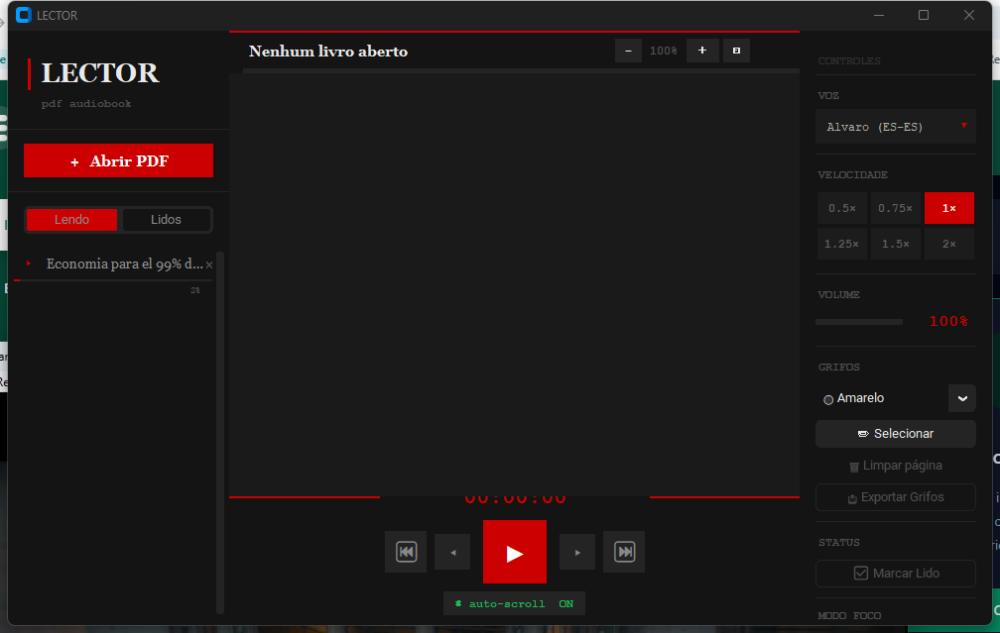
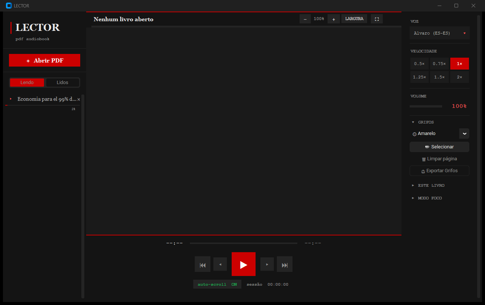
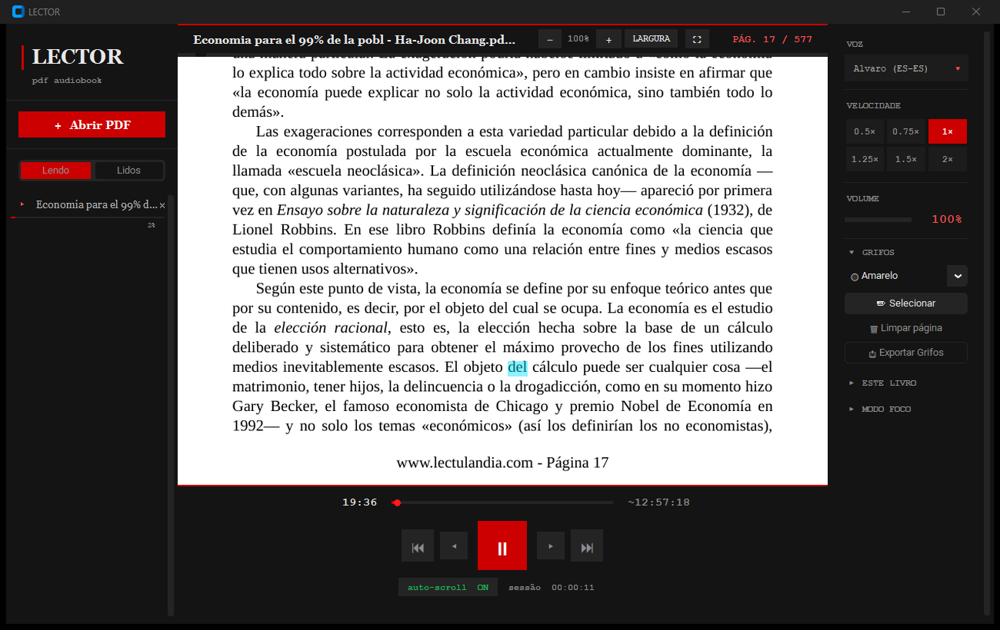
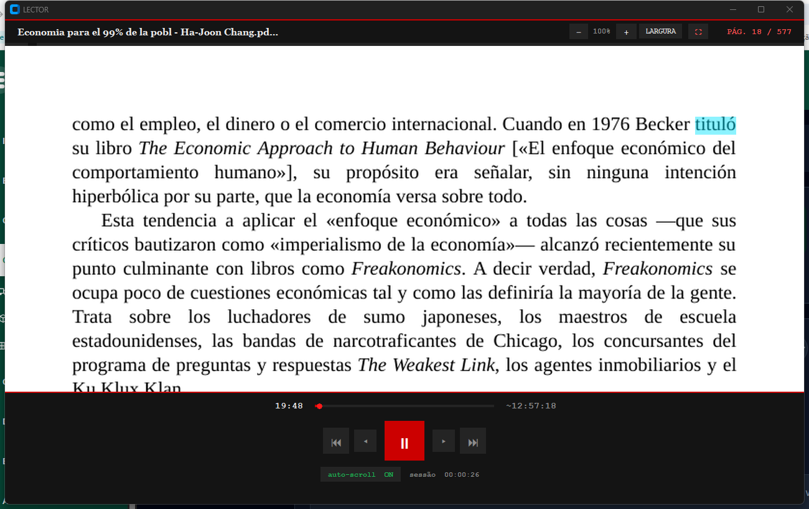

# UNIVERSIDADE DE FRANCA (UNIFRAN)
# CIÊNCIA DA COMPUTAÇÃO

**MATEUS HENRIQUE SILVA SOUZA**

**VINÍCIUS NUNES BENEDITO**

# LECTOR
## Leitor de PDF com narração sintetizada e acompanhamento visual sincronizado palavra a palavra

FRANCA

2026

---

**MATEUS HENRIQUE SILVA SOUZA**

**VINÍCIUS NUNES BENEDITO**

# LECTOR
## Leitor de PDF com narração sintetizada e acompanhamento visual sincronizado palavra a palavra

> Trabalho de Conclusão de Curso apresentado ao Curso de Ciência da
> Computação da Universidade de Franca (Unifran), como requisito para
> [DESCREVER A FINALIDADE CONFORME REGULAMENTO INSTITUCIONAL].
>
> Orientador: Prof. Dr. [NOME DO ORIENTADOR]

FRANCA

2026

---

## SUMÁRIO

1. IDENTIFICAÇÃO DO PROJETO
2. INTRODUÇÃO
3. PROBLEMA
4. JUSTIFICATIVA
5. OBJETIVOS
6. FUNDAMENTAÇÃO TEÓRICA
7. LEVANTAMENTO DE REQUISITOS
8. METODOLOGIA
9. TECNOLOGIAS E FERRAMENTAS
10. ARQUITETURA DA SOLUÇÃO
11. MODELAGEM DO SISTEMA
12. MODELAGEM DO BANCO DE DADOS
13. PROTOTIPAÇÃO E INTERFACE
14. DESENVOLVIMENTO E IMPLEMENTAÇÃO
15. VERSIONAMENTO E REPOSITÓRIO
16. TESTES E VALIDAÇÃO
17. RESULTADOS
18. DISCUSSÃO DOS RESULTADOS
19. SEGURANÇA, PRIVACIDADE E ÉTICA
20. LIMITAÇÕES DO PROJETO
21. TRABALHOS FUTUROS
22. CONCLUSÃO
23. CRONOGRAMA
24. REFERÊNCIAS
25. APÊNDICES
26. ANEXOS
27. REGISTRO DE CONTRIBUIÇÕES DA EQUIPE
28. CHECKLIST FINAL

---

# 1 IDENTIFICAÇÃO DO PROJETO

## 1.1 Título

**Lector: leitor de PDF com narração sintetizada e acompanhamento visual sincronizado palavra a palavra.**

## 1.2 Área do projeto

Engenharia de Software, com interface nas áreas de Interação
Humano-Computador e Acessibilidade Digital. O trabalho envolve ainda
processamento de documentos estruturados (extração de texto de arquivos
PDF) e consumo de serviço de síntese de voz (Text-to-Speech).

## 1.3 Resumo do projeto

A leitura de textos longos em formato PDF é parte central da rotina
acadêmica, mas o formato foi concebido para preservar a aparência
impressa da página, não para ser consumido em áudio. Ferramentas de
leitura em voz alta percorrem o documento na ordem em que o texto foi
gravado no arquivo, sem distinguir parágrafo de quebra de linha visual,
e produzem uma narração entrecortada. Soluções comerciais de audiolivro,
por sua vez, dependem de catálogos fechados e não aceitam o material que
o estudante já possui.

Este trabalho apresenta o Lector, uma aplicação desktop que converte
qualquer PDF com camada de texto em um audiolivro navegável, narrado por
voz sintetizada, com a palavra pronunciada destacada na própria página
enquanto o áudio toca. A solução foi desenvolvida em Python, utilizando
PyMuPDF para extração e renderização das páginas, a biblioteca edge-tts
para síntese de voz em português, inglês e espanhol, pygame para
reprodução de áudio e CustomTkinter para a interface gráfica.

O resultado é uma ferramenta funcional que reduziu o silêncio entre
trechos lidos de 1,39 s para 0,45 s — uma pausa a cada 21,7 s de leitura
em vez de uma a cada 8,9 s — e que localiza de 95,7% a 98,3% das
palavras faladas na página para o destaque visual. A aplicação possui
122 testes automatizados, verificação estática de estilo em integração
contínua e documentação técnica versionada junto ao código.

**Palavras-chave:** acessibilidade digital; síntese de voz; extração de
texto em PDF; sincronização áudio-texto; Python.

---

# 2 INTRODUÇÃO

O formato PDF (Portable Document Format) consolidou-se como padrão de
distribuição de material acadêmico justamente por sua característica
definidora: preservar a aparência da página independentemente do
dispositivo em que é aberto (ADOBE SYSTEMS, 2008). Essa fidelidade
visual, no entanto, tem um custo quando o objetivo deixa de ser ver a
página e passa a ser ouvi-la. Internamente, o PDF descreve onde cada
fragmento de texto deve ser desenhado, e não necessariamente qual é a
estrutura lógica do conteúdo: uma frase que ocupa três linhas na página
pode estar gravada como três fragmentos independentes.

A consequência prática aparece no momento em que esse texto é entregue a
um sintetizador de voz. Sem reconstruir a estrutura lógica do parágrafo,
cada linha visual tende a ser tratada como uma unidade de fala autônoma,
produzindo narração com pausas e entonação de fim de frase em pontos
onde a frase não terminou. O efeito é uma leitura entrecortada e
cansativa em sessões longas — exatamente o cenário de uso de um
estudante que precisa acompanhar centenas de páginas por disciplina.

Paralelamente, existe uma demanda por acessibilidade que o formato
isoladamente não atende. A Lei Brasileira de Inclusão da Pessoa com
Deficiência (BRASIL, 2015) firma o acesso à informação e à comunicação
como direito e trata a acessibilidade em meios digitais como condição
para o exercício da autonomia. Para pessoas com deficiência visual,
dislexia ou simplesmente com rotina que favorece o consumo auditivo, a
capacidade de ouvir um documento qualquer — e não apenas os títulos que
uma editora decidiu gravar — representa ganho concreto de autonomia.

Este trabalho parte dessa lacuna. O Lector foi concebido como uma
aplicação desktop que recebe um PDF com camada de texto e o transforma
em experiência de audiolivro: reconstrói os parágrafos a partir da
geometria da página, agrupa as frases em trechos de tamanho adequado
para a síntese de voz, narra o conteúdo com vozes neurais em três
idiomas e destaca visualmente, sobre a própria página renderizada, a
palavra que está sendo pronunciada naquele instante. A ferramenta agrega
ainda dicionário sob demanda, grifos persistentes, biblioteca com
retomada de progresso e modo de leitura focada.

O texto está organizado da seguinte forma. As seções 3 a 5 delimitam o
problema, a justificativa e os objetivos. A seção 6 reúne a
fundamentação teórica. As seções 7 a 13 documentam requisitos,
metodologia, tecnologias, arquitetura e modelagem. A seção 14 descreve a
implementação por módulo. As seções 15 a 18 tratam de versionamento,
testes e resultados medidos. As seções 19 a 22 discutem segurança,
limitações, trabalhos futuros e conclusão.

---

# 3 PROBLEMA

Ferramentas de leitura em voz alta disponíveis para documentos PDF
tratam o arquivo como sequência linear de fragmentos de texto. Como o
PDF não guarda, de forma confiável, a informação de onde termina um
parágrafo, essas ferramentas quebram a narração em pontos arbitrários —
tipicamente no fim de cada linha visual. O ouvinte percebe pausas no
meio de orações, entonação de encerramento onde a frase continua e, em
documentos com cabeçalho ou rodapé repetido, a leitura em voz alta de
elementos que não são conteúdo.

Esse comportamento foi quantificado durante o desenvolvimento. Em uma
página representativa de um livro técnico de 577 páginas, a extração
direta do texto produzia 49 unidades de fala com média de 9 palavras
cada, enquanto a estrutura lógica da mesma página corresponde a cerca de
11 parágrafos. Ou seja, aproximadamente três quartos das pausas da
narração caíam em pontos que não são fim de frase.

Além da fluidez, há o problema do acompanhamento visual. Para que o
áudio sirva como apoio ao estudo — e não apenas como substituto da
leitura —, é preciso que o usuário consiga localizar na página o trecho
narrado. Isso exige mapear o texto falado de volta às coordenadas da
palavra na página renderizada, correspondência que não é direta: o texto
entregue ao sintetizador passou por limpeza (remoção de hifenização de
fim de linha, de cabeçalhos repetidos e normalização de espaços) e não é
idêntico ao que está gravado no arquivo.

**Pergunta norteadora:** é possível construir uma aplicação que converta
um arquivo PDF arbitrário em experiência de audiolivro, com fluidez de
narração comparável à da fala natural e com acompanhamento visual
sincronizado em nível de palavra, utilizando exclusivamente bibliotecas
de código aberto e serviços de síntese de voz gratuitos?

---

# 4 JUSTIFICATIVA

A justificativa do projeto apoia-se em três eixos.

**Eixo legal e de acessibilidade.** A Lei nº 13.146/2015 — Lei
Brasileira de Inclusão da Pessoa com Deficiência — institui o acesso à
informação e à comunicação como direito e trata a acessibilidade em
meios digitais como condição para o exercício da autonomia (BRASIL,
2015). As Diretrizes de Acessibilidade para Conteúdo Web (W3C, 2018),
adotadas como referência técnica no Brasil, estabelecem critérios
objetivos de percepção de conteúdo, entre eles razões mínimas de
contraste entre texto e fundo. Este trabalho aplica tais critérios à
própria interface e documenta a verificação na seção 17.3.

**Eixo técnico.** A disponibilidade de vozes neurais de alta qualidade
por meio de serviços gratuitos alterou a viabilidade desse tipo de
aplicação. O que antes exigia licenciamento de motores comerciais de
síntese hoje pode ser obtido com bibliotecas abertas. O desafio
deslocou-se da qualidade da voz para a preparação do texto e para a
sincronização entre áudio e página — que é precisamente onde este
trabalho concentra sua contribuição, com resultados mensurados e
reprodutíveis.

**Eixo acadêmico e de uso.** O volume de leitura exigido no ensino
superior é alto e majoritariamente distribuído em PDF. Uma ferramenta
que permita ouvir esse material enquanto se acompanha visualmente o
texto — sem depender de catálogo comercial, sem custo e preservando
grifos e progresso entre sessões — atende a necessidade concreta. O
projeto tem ainda valor como exercício de Engenharia de Software: o
repositório documenta um ciclo completo de auditoria de código, correção
de defeitos de concorrência e refatoração orientada por medição,
descrito na seção 8.

---

# 5 OBJETIVOS

## 5.1 Objetivo geral

Desenvolver uma aplicação desktop capaz de converter arquivos PDF com
camada de texto em audiolivros navegáveis, com narração por voz
sintetizada e destaque visual sincronizado em nível de palavra sobre a
página renderizada.

## 5.2 Objetivos específicos

1. Reconstruir a estrutura lógica do texto a partir da geometria da
   página, de modo que a unidade enviada ao sintetizador de voz seja a
   frase ou o parágrafo, e não a linha visual do arquivo.
2. Reduzir o silêncio entre trechos narrados a valor compatível com a
   pausa natural entre frases da fala humana, medindo o resultado antes
   e depois da intervenção.
3. Sincronizar o destaque visual com o áudio em nível de palavra,
   mapeando as marcações temporais devolvidas pelo sintetizador às
   coordenadas da palavra correspondente na página.
4. Implementar navegação em três granularidades — trecho, página e
   posição temporal no livro — com retomada automática do ponto de
   leitura entre sessões.
5. Oferecer recursos de apoio ao estudo: consulta de dicionário sob
   demanda, grifos persistentes exportáveis e sumário navegável.
6. Garantir a legibilidade da interface segundo critérios objetivos de
   contraste, verificando cada par de cor texto/fundo utilizado.
7. Assegurar a qualidade do código por meio de testes automatizados,
   verificação estática de estilo e integração contínua.

---

# 6 FUNDAMENTAÇÃO TEÓRICA

## 6.1 Conceitos principais

### 6.1.1 O formato PDF e a extração de texto

O PDF é um formato de descrição de página: o arquivo especifica quais
glifos devem ser desenhados, com qual fonte e em quais coordenadas
(ADOBE SYSTEMS, 2008). Diferentemente de formatos com marcação
semântica, o PDF não é obrigado a registrar onde começa ou termina um
parágrafo. Uma biblioteca de extração recupera os fragmentos de texto e
suas posições, mas a reconstrução da estrutura lógica — agrupar
fragmentos em linhas e linhas em parágrafos — é inferência feita a
partir da geometria.

A biblioteca PyMuPDF (ARTIFEX SOFTWARE, 2025) expõe essa informação em
diferentes níveis de granularidade: texto corrido, blocos, linhas e
palavras individuais com seus retângulos delimitadores. A escolha do
nível adequado é determinante para a qualidade do resultado, conforme
demonstrado na seção 14.1.

### 6.1.2 Síntese de voz e marcação temporal

Sistemas de Text-to-Speech (TTS) convertem texto escrito em áudio.
Motores neurais produzem fala com prosódia natural, mas operam sobre a
unidade de texto que recebem: a entonação é calculada para o enunciado
inteiro. Isso implica que fragmentar o texto de entrada altera o
resultado sonoro — um trecho encerrado artificialmente recebe cadência
de fim de frase, ainda que a oração continue.

Além do áudio, protocolos de síntese podem devolver marcações temporais
(boundaries) indicando o instante em que cada palavra é pronunciada. É
essa informação que viabiliza o acompanhamento visual sincronizado. O
serviço utilizado neste trabalho, por meio da biblioteca edge-tts
(RANY2, 2025), oferece marcação em nível de palavra (WordBoundary) e de
sentença (SentenceBoundary).

### 6.1.3 Sincronização entre áudio e documento

O acompanhamento visual exige resolver uma correspondência: dada a
palavra pronunciada no instante t, qual retângulo da página deve ser
destacado? O problema não é trivial porque o texto enviado ao
sintetizador passou por transformações — dehifenização, remoção de
cabeçalhos e rodapés repetidos, normalização de espaços — e não coincide
literalmente com o texto gravado no arquivo.

Duas estratégias são possíveis: (i) buscar o texto falado de volta no
documento por casamento aproximado, ou (ii) preservar, desde a extração,
o vínculo entre cada palavra do texto preparado e sua posição original.
A seção 14.2 descreve a abordagem adotada, que é uma variação da
segunda: a lista de palavras da página é lida uma única vez e casada,
com cursor progressivo, contra a sequência de marcações temporais
devolvida pelo sintetizador.

### 6.1.4 Acessibilidade e contraste

As Diretrizes de Acessibilidade para Conteúdo Web (W3C, 2018)
estabelecem, no critério de sucesso 1.4.3, razão mínima de contraste de
4,5:1 entre texto e fundo para texto comum e de 3:1 para texto ampliado.
A razão é calculada a partir da luminância relativa das duas cores,
segundo fórmula definida na própria norma. Esse critério, originalmente
formulado para conteúdo web, é aplicável a qualquer interface gráfica e
foi adotado neste trabalho como régua objetiva de legibilidade.

## 6.2 Tecnologias e abordagens relacionadas

**Concorrência em interfaces gráficas.** Bibliotecas de interface
baseadas em Tcl/Tk — caso do Tkinter e, por extensão, do CustomTkinter —
exigem que operações sobre widgets ocorram na thread principal (PYTHON
SOFTWARE FOUNDATION, 2025). Operações de longa duração, como requisições
de rede ou renderização de páginas, precisam executar em threads
separadas e devolver o resultado à thread de interface por mecanismo de
agendamento. O projeto aplica esse padrão de forma sistemática, descrito
na seção 10.3.

**Cancelamento de trabalho obsoleto.** Quando uma operação longa pode
ser reiniciada antes de concluir, é necessário invalidar a execução
anterior. O projeto emprega um token de geração: cada execução recebe um
número e só continua a produzir efeitos enquanto esse número for o mais
recente. A abordagem substitui um sinalizador booleano compartilhado,
que apresentava condição de corrida quando a thread antiga estava
bloqueada em espera de rede no instante em que o sinalizador era
reiniciado.

**Estimativa de duração sem mídia pré-existente.** Como o áudio é
sintetizado sob demanda, não existe arquivo cuja duração possa ser
medida para compor a barra de progresso temporal. A duração é estimada a
partir da quantidade de texto, com constante de caracteres por segundo
calibrada durante a própria leitura. A seção 14.4 detalha por que a
posição exibida não pode ser derivada dessa estimativa.

## 6.3 Trabalhos relacionados

| Solução | Entrada aceita | Acompanhamento visual | Diferença em relação ao Lector |
|---|---|---|---|
| Leitores de tela (NVDA, JAWS, Narrador do Windows) | Qualquer aplicação | Cursor do leitor, sem relação com a página renderizada | Leem o texto na ordem do arquivo, sem reconstruir parágrafos; não exibem a página |
| Adobe Acrobat Reader — recurso "Ler em voz alta" | PDF | Não destaca a palavra sobre a página | Narração por linha visual; utiliza vozes do sistema operacional |
| Serviços de audiolivro (Audible, Storytel) | Catálogo fechado | Alguns títulos com texto sincronizado | Não aceitam PDF do usuário; dependem de gravação prévia |
| Extensões de navegador para leitura em voz alta | Página web ou PDF aberto no navegador | Destaque em nível de sentença | Dependem do navegador; granularidade menor |
| **Lector (este trabalho)** | **PDF local com camada de texto** | **Palavra destacada sobre a página renderizada** | **Requer conexão com a internet para a síntese de voz** |

A diferença central da proposta está na combinação de três
características que, nas soluções levantadas, aparecem isoladamente:
aceitar qualquer PDF do usuário, reconstruir a estrutura lógica do texto
antes da síntese e destacar a palavra pronunciada sobre a página
original.

> **Nota aos autores.** Esta seção apresenta levantamento comparativo com
> base na documentação pública dos produtos citados. Recomenda-se
> complementá-la com literatura acadêmica revisada por pares sobre
> síntese de voz aplicada à acessibilidade e sobre extração estrutural de
> documentos PDF, selecionada pelos autores junto ao orientador. As
> referências da seção 24 listam apenas fontes verificáveis efetivamente
> consultadas durante o desenvolvimento.

---

# 7 LEVANTAMENTO DE REQUISITOS

## 7.1 Público-alvo

Estudantes do ensino superior e profissionais que precisam consumir
volume alto de material técnico distribuído em PDF, e que se beneficiam
de leitura auditiva com acompanhamento visual. Inclui, de forma
específica, pessoas com deficiência visual parcial, com dislexia ou com
outras condições que tornam a leitura prolongada em tela cansativa, bem
como leitores que desejam aproveitar deslocamentos e atividades
manuais para estudar.

## 7.2 Perfis de usuários

| Perfil | Descrição | Necessidade principal |
|---|---|---|
| Estudante em sessão de estudo | Lê e ouve simultaneamente, grifa trechos e consulta termos desconhecidos | Acompanhamento visual preciso e recursos de anotação |
| Ouvinte em atividade paralela | Ouve sem olhar a tela, durante deslocamento ou tarefa manual | Fluidez da narração e navegação por tempo |
| Leitor com baixa visão | Depende da ampliação do texto e de contraste adequado | Ajuste de página por largura e interface legível |
| Revisor de material próprio | Retoma documentos já lidos para localizar passagens | Busca textual, sumário e grifos exportáveis |

## 7.3 Requisitos funcionais

| Código | Requisito | Descrição | Prioridade |
|---|---|---|---|
| RF01 | Abrir documento PDF | Carregar arquivo PDF local com camada de texto, exibindo mensagem clara em caso de arquivo corrompido, protegido por senha ou sem páginas | Alta |
| RF02 | Narrar o conteúdo | Converter o texto da página em áudio por síntese de voz e reproduzi-lo sequencialmente | Alta |
| RF03 | Reconstruir parágrafos | Agrupar as linhas visuais da página em parágrafos antes do envio ao sintetizador | Alta |
| RF04 | Destacar a palavra narrada | Sobrepor à página renderizada o retângulo da palavra pronunciada no instante corrente | Alta |
| RF05 | Controlar a reprodução | Iniciar, pausar e navegar por trecho anterior/seguinte e página anterior/seguinte | Alta |
| RF06 | Selecionar voz e velocidade | Permitir escolha entre vozes de três idiomas e seis velocidades de leitura | Média |
| RF07 | Ajustar volume | Controlar o volume da narração | Média |
| RF08 | Navegar por tempo | Exibir posição atual e duração estimada do livro, e permitir salto para instante escolhido | Média |
| RF09 | Rolagem automática | Acompanhar a narração deslocando a página automaticamente, com possibilidade de desativar | Média |
| RF10 | Consultar dicionário | Exibir a definição de uma palavra ao clique sobre ela, com detecção automática de idioma | Média |
| RF11 | Criar e remover grifos | Marcar trechos por seleção retangular e removê-los por clique com o botão direito | Média |
| RF12 | Exportar grifos | Gerar arquivo Markdown com os grifos do livro e o texto correspondente | Baixa |
| RF13 | Manter biblioteca | Listar livros abertos, exibir progresso e separar lidos de não lidos | Média |
| RF14 | Retomar leitura | Restaurar página e trecho correntes ao reabrir um livro | Alta |
| RF15 | Buscar texto | Localizar termo em todo o documento e navegar entre as ocorrências | Média |
| RF16 | Exibir sumário | Apresentar o sumário embutido do PDF e permitir salto para o capítulo | Baixa |
| RF17 | Modo foco | Bloquear troca de livro e fechamento do aplicativo por período determinado | Baixa |
| RF18 | Modo leitura | Ocultar painéis laterais para ampliar a área de leitura | Baixa |
| RF19 | Persistir preferências | Manter voz, velocidade, volume, zoom, modo de ajuste e demais preferências entre sessões | Média |

## 7.4 Requisitos não funcionais

| Código | Requisito | Descrição | Prioridade |
|---|---|---|---|
| RNF01 | Fluidez da narração | O silêncio entre trechos consecutivos deve aproximar-se da pausa natural entre frases, abaixo de 0,6 s | Alta |
| RNF02 | Responsividade da interface | Nenhuma operação de rede, disco ou renderização pode bloquear a thread de interface | Alta |
| RNF03 | Legibilidade | Todo par de cor texto/fundo deve atingir a razão mínima de contraste definida pela WCAG 2.1 nível AA | Alta |
| RNF04 | Integridade dos dados do usuário | Gravações de biblioteca, grifos e preferências devem ser atômicas e preservar o arquivo anterior em caso de corrupção | Alta |
| RNF05 | Tolerância a falha de rede | Falha na síntese de voz deve informar o usuário e permitir a continuidade, sem encerrar a aplicação | Alta |
| RNF06 | Segurança de concorrência | Acesso ao documento PDF a partir de múltiplas threads deve ser serializado | Alta |
| RNF07 | Uso de memória | O cache de páginas renderizadas deve ser limitado para não crescer indefinidamente em livros extensos | Média |
| RNF08 | Adaptação a janelas pequenas | Nenhum controle pode tornar-se inacessível na resolução mínima suportada (900x600) | Média |
| RNF09 | Qualidade de código | O repositório deve manter verificação estática de estilo e suíte de testes executadas em integração contínua | Média |
| RNF10 | Portabilidade | A aplicação deve executar em Windows a partir de código-fonte ou de executável único | Média |

---

# 8 METODOLOGIA

O desenvolvimento seguiu abordagem incremental, organizada em quatro
ciclos identificáveis no histórico do repositório (seção 23).

**Ciclo 1 — Prototipação funcional (maio de 2026).** Construção da
versão inicial: abertura de PDF, extração de texto, narração sequencial,
navegação por trechos e dicionário interativo. O objetivo era validar a
viabilidade técnica da integração entre PyMuPDF, edge-tts e pygame. Ao
final do ciclo, a interface foi modularizada em componentes e gerou-se o
primeiro executável.

**Ciclo 2 — Auditoria de robustez (agosto a outubro de 2026).** Revisão
sistemática do código em busca de defeitos de concorrência, tratamento
de erro e consistência de estado. Esse ciclo produziu correções
documentadas individualmente: substituição de sinalizador compartilhado
por token de geração no laço de leitura, proteção do renderizador de PDF
com trava reentrante, identificação de grifos por identificador único em
lugar de índice de lista, e correção de contagem dupla da posição de
áudio na pausa. Cada correção foi acompanhada de teste automatizado.

**Ciclo 3 — Refatoração orientada por medição (novembro de 2026).** A
queixa que originou o ciclo foi qualitativa: a narração apresentava
pausas não naturais. O método adotado foi instrumentar antes de
intervir. Mediu-se a composição do silêncio entre trechos, o custo de
cada etapa do laço de leitura e a distribuição de unidades de fala por
página. Só então as alterações foram implementadas, e cada uma foi
reavaliada com a mesma instrumentação. A seção 17 apresenta os números
antes e depois.

**Ciclo 4 — Revisão de interface (novembro de 2026).** Aplicação do
mesmo método a aspectos visuais. Em vez de julgamento estético, foram
estabelecidas duas réguas objetivas: a proporção da janela efetivamente
ocupada pela página do livro e a razão de contraste de cada par de cor
texto/fundo. Ambas foram medidas, os defeitos corrigidos e as medições
refeitas.

**Procedimentos de verificação.** Em todos os ciclos adotaram-se:
testes automatizados com pytest, verificação estática de estilo com
ruff, execução de ambos em integração contínua a cada envio à branch
principal, e verificação manual da aplicação em execução com um livro
real de 577 páginas. Scripts de instrumentação foram escritos
especificamente para medir cada característica avaliada, de modo que os
números apresentados na seção 17 sejam reprodutíveis.

---

# 9 TECNOLOGIAS E FERRAMENTAS

| Tecnologia/Ferramenta | Versão | Finalidade no projeto |
|---|---|---|
| Python | 3.11.9 | Linguagem de implementação. Escolhida pela maturidade do ecossistema de manipulação de PDF e pelo suporte nativo a programação assíncrona, usada no laço de leitura |
| PyMuPDF | 2.0 | Abertura do PDF, renderização das páginas em imagem, extração de texto em níveis de bloco, linha e palavra, e leitura do sumário embutido |
| edge-tts | 7.3.1 | Síntese de voz neural em português, inglês e espanhol, com marcação temporal em nível de palavra |
| pygame | 2.6.1 | Reprodução do áudio MP3 a partir da memória e consulta da posição corrente de reprodução |
| CustomTkinter | 6.0.0 | Componentes de interface com aparência moderna sobre o Tkinter da biblioteca padrão |
| Pillow | 13.0.0 | Composição dos grifos sobre a imagem da página, redimensionamento e recorte da área visível |
| langdetect | 1.0.9 | Detecção do idioma da página para direcionar a consulta ao dicionário correto |
| requests | 2.34.2 | Requisições HTTP às fontes de definição de palavras |
| BeautifulSoup | 4.15.0 | Extração das definições a partir do HTML retornado pelo dicionário em português |
| pytest | 9.2.0 | Execução da suíte de testes automatizados e medição de cobertura |
| ruff | 0.17.3 | Verificação estática de estilo e detecção de erros comuns |
| Git e GitHub | — | Versionamento do código e hospedagem do repositório |
| GitHub Actions | — | Integração contínua: execução de ruff e pytest a cada envio |
| PyInstaller | — | Geração de executável único para distribuição em Windows |

A escolha por `edge-tts` em lugar de motores locais deve-se à qualidade
das vozes neurais e à disponibilidade de marcação temporal por palavra,
recurso indispensável ao objetivo específico 3. A contrapartida —
necessidade de conexão com a internet — está registrada na seção 20 e
suas implicações de privacidade, na seção 19.

---

# 10 ARQUITETURA DA SOLUÇÃO

## 10.1 Visão geral

A aplicação organiza-se em três camadas, com dependência unidirecional:
a interface conhece o núcleo e a persistência, mas nenhum módulo de
`core/` ou `data/` importa código de interface. Essa regra é o que
permite que a lógica seja testada sem abrir janela, e é verificada na
prática: nenhum dos 12 arquivos de teste importa o pacote `ui`.

```
                    ┌─────────────────────────────┐
                    │           ui/               │
                    │  (CustomTkinter + Tkinter)  │
                    │                             │
                    │  app.py  — janela, estado   │
                    │  sidebar · viewer · controls│
                    │  right_panel · highlights   │
                    │  dict_popup · toc · focus   │
                    └──────────┬──────────┬───────┘
                               │          │
              ┌────────────────┘          └───────────────┐
              ▼                                           ▼
   ┌─────────────────────────┐              ┌──────────────────────────┐
   │        core/            │              │         data/            │
   │  (lógica sem interface) │              │  (persistência em JSON)  │
   │                         │              │                          │
   │  pdf_renderer           │              │  library   · highlights  │
   │  text · tts · player    │              │  prefs     · history     │
   │  word_sync · duration   │              │  _jsonio (escrita        │
   │  dictionary · generation│              │           atômica)       │
   └───────┬─────────┬───────┘              └──────────┬───────────────┘
           │         │                                 │
           ▼         ▼                                 ▼
   ┌───────────┐ ┌─────────────┐              ┌─────────────────┐
   │ Documento │ │  Serviços   │              │ Arquivos JSON   │
   │   PDF     │ │  externos   │              │ no disco local  │
   │ (local)   │ │ edge-tts /  │              │                 │
   │           │ │ dicionários │              │                 │
   └───────────┘ └─────────────┘              └─────────────────┘
```

*Figura 1 — Arquitetura geral da solução. Fonte: elaborado pelos autores.*

## 10.2 Responsabilidade de cada módulo

**Camada `core/` — lógica independente de interface**

| Módulo | Responsabilidade |
|---|---|
| `pdf_renderer.py` | Abre o documento, renderiza páginas em imagem, extrai texto com parágrafos reconstruídos, fornece as palavras da página com seus retângulos, detecta cabeçalhos e rodapés repetidos e expõe o sumário |
| `text.py` | Divide o texto em frases, tratando abreviações, números decimais e reticências, e agrupa as frases nos trechos enviados ao sintetizador |
| `tts.py` | Gera o áudio e as marcações temporais por palavra; informa em que instante a fala termina dentro do arquivo |
| `player.py` | Reproduz o áudio e informa a posição corrente |
| `word_sync.py` | Casa a sequência de palavras faladas com as palavras da página, devolvendo o retângulo de cada uma |
| `duration.py` | Estima a duração total do livro e converte entre instante e posição no documento |
| `dictionary.py` | Consulta definições de palavras em três idiomas, com cache limitado e protegido |
| `generation.py` | Token de geração para cancelamento de trabalho obsoleto entre threads |

**Camada `data/` — persistência**

| Módulo | Responsabilidade |
|---|---|
| `_jsonio.py` | Leitura e escrita atômica de JSON, com backup de arquivo corrompido |
| `library.py` | Biblioteca de livros: progresso, total de páginas, estado de leitura |
| `highlights.py` | Grifos por livro e página, identificados por UUID |
| `prefs.py` | Preferências de leitura persistidas entre sessões |
| `history.py` | Histórico de sessões de leitura |

**Camada `ui/` — interface**

A janela principal é composta por mixins, cada um responsável por uma
região ou função: barra lateral (biblioteca), visualizador (página,
zoom, busca), controles (transporte e barra de tempo), painel direito
(ajustes), grifos, dicionário, sumário e modo foco. A classe `App`
reúne os mixins e concentra o estado compartilhado.

## 10.3 Modelo de concorrência

A thread principal é propriedade exclusiva da interface. Toda operação
de longa duração executa em thread separada e devolve o resultado por
agendamento na thread de interface:

| Operação | Onde executa | Retorno à interface |
|---|---|---|
| Abertura do PDF | Thread dedicada | Agendamento com resultado ou erro |
| Renderização de página | Thread dedicada | Agendamento, descartado se a página já não for a corrente |
| Pré-renderização de páginas vizinhas | Threads auxiliares | Apenas preenche cache |
| Laço de leitura (síntese e reprodução) | Thread dedicada com laço assíncrono | Agendamento a cada mudança de destaque |
| Consulta ao dicionário | Thread dedicada | Agendamento com a definição |
| Busca em todas as páginas | Thread dedicada | Agendamento com os resultados |

Dois mecanismos garantem a consistência. O **token de geração** invalida
o laço de leitura anterior quando o usuário navega: a thread antiga
verifica o token antes de qualquer escrita de estado ou reprodução e
encerra silenciosamente se já não for a corrente. A **trava reentrante**
no renderizador serializa o acesso ao documento, que não é seguro para
uso concorrente.

---

# 11 MODELAGEM DO SISTEMA

## 11.1 Diagrama de casos de uso

```
                            ┌──────────────────────────────────────┐
                            │              LECTOR                  │
                            │                                      │
                            │   ( Abrir PDF )                      │
                            │   ( Ouvir narração )                 │
   ┌────────┐               │   ( Navegar por trecho/página )      │
   │        │───────────────│   ( Navegar por tempo )              │
   │ Leitor │               │   ( Ajustar voz/velocidade/volume )  │
   │        │               │   ( Consultar dicionário ) ──────────┼──┐
   └────────┘               │   ( Criar/remover grifo )            │  │
        │                   │   ( Exportar grifos )                │  │
        │                   │   ( Buscar texto )                   │  │
        │                   │   ( Ver sumário )                    │  │
        │                   │   ( Ativar modo foco )               │  │
        │                   │   ( Ativar modo leitura )            │  │
        │                   │                                      │  │
        │                   │   ( Ouvir narração ) ────────────────┼──┼──┐
        │                   └──────────────────────────────────────┘  │  │
        │                                                             │  │
        │                                     ┌───────────────────────▼──▼────┐
        └─────────────────────────────────────│  Serviços externos            │
                                              │  (síntese de voz, dicionários)│
                                              └───────────────────────────────┘
```

*Figura 2 — Casos de uso. Fonte: elaborado pelos autores.*

| Caso de uso | Ator | Pré-condição | Fluxo principal |
|---|---|---|---|
| Abrir PDF | Leitor | Arquivo acessível com camada de texto | Seleciona o arquivo; o sistema abre em segundo plano, detecta cabeçalhos repetidos, calcula a duração estimada e restaura a última posição |
| Ouvir narração | Leitor | Livro aberto | Aciona reproduzir; o sistema monta os trechos, sintetiza o áudio do trecho corrente, pré-gera o seguinte, reproduz e destaca cada palavra |
| Navegar por tempo | Leitor | Livro aberto | Clica na barra de tempo; o sistema converte o instante em página e trecho e reinicia a leitura naquele ponto |
| Consultar dicionário | Leitor | Livro aberto | Clica sobre uma palavra; o sistema identifica a palavra pela coordenada, detecta o idioma da página e consulta a fonte correspondente |
| Criar grifo | Leitor | Modo de seleção ativo | Arrasta sobre a região desejada; o sistema converte as coordenadas de tela em pontos do PDF e persiste o grifo |

## 11.2 Diagrama de classes

```
┌──────────────────────────┐        ┌───────────────────────────┐
│       PDFRenderer        │        │      BookTimeline         │
├──────────────────────────┤        ├───────────────────────────┤
│ - _doc, _lock            │        │ - _cum: list[int]         │
│ - _cache (LRU páginas)   │        │ - _samples: deque         │
│ - _words_cache           │        │ + speed_pct               │
│ - _skip (cabeç./rodapés) │        ├───────────────────────────┤
│ + total, page_lengths    │        │ + total_seconds           │
├──────────────────────────┤        │ + seconds_at(pág, fração) │
│ + render_page(n)         │        │ + locate(segundos)        │
│ + text_for_page(n)       │        │ + observe(chars, seg)     │
│ + word_rects(n)          │        └───────────────────────────┘
│ + search_text(n, texto)  │                    ▲
│ + text_in_rect(...)      │                    │ usa
│ + word_at(n, x, y)       │                    │
│ + get_toc()              │        ┌───────────┴───────────────┐
│ + prefetch(n) / close()  │        │           App             │
└──────────────────────────┘        │  (SidebarMixin, Viewer-   │
            ▲                       │   Mixin, ControlsMixin,   │
            │ usa                   │   RightPanelMixin,        │
            │                       │   HighlightsMixin,        │
┌───────────┴──────────────┐        │   DictPopupMixin,         │
│    core.word_sync        │        │   TocMixin, FocusMixin)   │
│      (funções)           │◄───────┤                           │
├──────────────────────────┤  usa   ├───────────────────────────┤
│ + word_bboxes(palavras,  │        │ - renderer: PDFRenderer   │
│     timings, cursor)     │        │ - player: Player          │
│ + match_forward(...)     │        │ - _timeline: BookTimeline │
│ + anchor_chunk(...)      │        │ - _read_gen: Generation-  │
│ + merge_rects_by_line()  │        │              Guard        │
└──────────────────────────┘        │ - current_page            │
                                    │ - current_chunk_idx       │
┌──────────────────────────┐        ├───────────────────────────┤
│         Player           │◄───────┤ + _read_loop(gen) async   │
├──────────────────────────┤  usa   │ + _toggle_play()          │
│ - _volume, _paused       │        │ + _on_time_seek(fração)   │
│ - _offset_seconds        │        │ + _show_page(n)           │
├──────────────────────────┤        │ + _draw_image(img)        │
│ + play(data) / pause()   │        └───────────────────────────┘
│ + unpause() / stop()     │                    │ usa
│ + get_pos() / is_busy()  │                    ▼
└──────────────────────────┘        ┌───────────────────────────┐
                                    │     GenerationGuard       │
┌──────────────────────────┐        ├───────────────────────────┤
│   core.text (funções)    │        │ - _gen: int, _lock        │
├──────────────────────────┤        ├───────────────────────────┤
│ + split_sentences(texto) │        │ + next() / invalidate()   │
│ + build_chunks(texto)    │        │ + is_current(token)       │
└──────────────────────────┘        └───────────────────────────┘

┌──────────────────────────┐
│    core.tts (funções)    │
├──────────────────────────┤
│ + speak(texto, voz, vel) │  → (bytes MP3, marcações temporais)
│ + speech_end(timings)    │  → instante em que a fala termina
└──────────────────────────┘
```

*Figura 3 — Diagrama de classes (simplificado). Fonte: elaborado pelos autores.*

## 11.3 Diagrama de sequência — laço de leitura

O diagrama abaixo representa o ciclo de um trecho, que é a operação
central do sistema.

```
Usuário    App/_read_loop   core.text   core.tts   PDFRenderer  word_sync   Player
   │             │              │           │           │           │          │
   │──reproduzir→│              │           │           │           │          │
   │             │──text_for_page(n)────────────────────→│           │          │
   │             │←─ texto com 1 parágrafo por linha ────│           │          │
   │             │──build_chunks(texto)────→│            │           │          │
   │             │←─ trechos de ~240 car. ──│            │           │          │
   │             │                          │            │           │          │
   │             │──speak(trecho[i])───────────────→│    │           │          │
   │             │  (assíncrono; já dispara trecho[i+1]) │           │          │
   │             │←── MP3 + marcações por palavra ──│    │           │          │
   │             │                                       │           │          │
   │             │──word_rects(n)───────────────────────→│           │          │
   │             │←── palavras com retângulos (cache) ───│           │          │
   │             │──word_bboxes(palavras, marcações, cursor)────────→│          │
   │             │←── [(início, fim, retângulo)] + novo cursor ──────│          │
   │             │                                                   │          │
   │             │──desenha o trecho inteiro (fundo tênue)──────────────────────→│
   │             │──play(MP3)──────────────────────────────────────────────────→│
   │             │                                                   │          │
   │             │  laço a cada 30 ms enquanto houver fala:           │          │
   │             │──get_pos()──────────────────────────────────────────────────→│
   │             │←─ posição corrente ─────────────────────────────────────────│
   │←─ destaque da palavra + rolagem automática ─┐                   │          │
   │             │  interrompe em speech_end(marcações)               │          │
   │             │  pausa deliberada de 0,05 s                        │          │
   │             │  próximo trecho                                    │          │
```

*Figura 4 — Sequência do laço de leitura de um trecho. Fonte: elaborado pelos autores.*

## 11.4 Fluxograma — preparação do texto para a narração

```
            ┌─────────────────────────┐
            │  Página n do documento  │
            └────────────┬────────────┘
                         ▼
            ┌─────────────────────────────────────┐
            │ Extrair BLOCOS de texto (PyMuPDF)   │
            │ — não linhas soltas                 │
            └────────────┬────────────────────────┘
                         ▼
            ┌─────────────────────────────────────┐
            │ Para cada bloco:                    │
            │  • remover hifenização de fim de    │
            │    linha                            │
            │  • descartar cabeçalho/rodapé       │
            │    repetido (dígitos mascarados)    │
            │  • descartar número de página solto │
            │  • juntar as linhas com espaço      │
            └────────────┬────────────────────────┘
                         ▼
            ┌─────────────────────────────────────┐
            │ Texto com UM PARÁGRAFO por linha    │
            └────────────┬────────────────────────┘
                         ▼
            ┌─────────────────────────────────────┐
            │ Dividir em frases, preservando:     │
            │  abreviações · decimais · reticências│
            └────────────┬────────────────────────┘
                         ▼
            ┌─────────────────────────────────────┐
            │ Agrupar frases do MESMO parágrafo   │
            │ até ~240 caracteres                 │
            │ (frase longa demais é cortada em    │
            │  ponto de oração)                   │
            └────────────┬────────────────────────┘
                         ▼
            ┌─────────────────────────────────────┐
            │ Trechos enviados ao sintetizador    │
            └─────────────────────────────────────┘
```

*Figura 5 — Preparação do texto. Fonte: elaborado pelos autores.*

---

# 12 MODELAGEM DO BANCO DE DADOS

O projeto **não utiliza sistema gerenciador de banco de dados**. A
decisão é arquitetural e justifica-se por três fatores: a aplicação é
monousuário e local; o volume de dados é pequeno (metadados de livros,
grifos e preferências); e a ausência de dependência externa simplifica a
distribuição em executável único, sem instalação de serviço adicional.

A persistência é feita em arquivos JSON gravados na pasta da aplicação —
ou, quando essa pasta não é gravável, em diretório de dados do usuário.
Toda escrita é atômica: o conteúdo é gravado em arquivo temporário e
renomeado sobre o destino, de modo que uma interrupção não deixe arquivo
parcialmente escrito. Arquivo corrompido é preservado com extensão
`.corrupted` em vez de descartado.

## 12.1 Modelo conceitual

```
   ┌───────────────┐              ┌────────────────┐
   │     LIVRO     │ 1          N │     GRIFO      │
   │               │──────────────│                │
   │ caminho (PK)  │   possui     │ id (UUID, PK)  │
   │ última página │              │ página         │
   │ último trecho │              │ x0, y0, x1, y1 │
   │ total páginas │              │ cor, opacidade │
   │ concluído     │              └────────────────┘
   └───────┬───────┘
           │ 1
           │ gera
           │ N
   ┌───────▼───────────┐          ┌────────────────────┐
   │      SESSÃO       │          │    PREFERÊNCIA     │
   │                   │          │   (registro único) │
   │ início            │          │ voz, velocidade    │
   │ duração           │          │ volume, zoom       │
   │ segundos          │          │ modo de ajuste     │
   │ livro             │          │ rolagem automática │
   └───────────────────┘          │ cor de grifo       │
                                  │ seções do painel   │
                                  │ modo leitura       │
                                  └────────────────────┘
```

*Figura 6 — Modelo conceitual dos dados persistidos. Fonte: elaborado pelos autores.*

## 12.2 Modelo lógico

Cada entidade corresponde a um arquivo JSON:

| Arquivo | Estrutura | Chave |
|---|---|---|
| `library.json` | Objeto: caminho do arquivo → metadados do livro | Caminho absoluto do PDF |
| `highlights.json` | Objeto: caminho → objeto: número da página → lista de grifos | Caminho + página + UUID do grifo |
| `prefs.json` | Objeto plano de preferências | Nome da preferência |
| `history.json` | Lista de registros de sessão | Ordem de inserção |

## 12.3 Dicionário de dados

**`library.json` — metadados por livro**

| Campo | Tipo | Descrição | Restrição |
|---|---|---|---|
| (chave) | string | Caminho absoluto do arquivo PDF | Obrigatório, único |
| `last_page` | inteiro | Última página exibida, base zero | ≥ 0 |
| `last_chunk_idx` | inteiro | Índice do trecho corrente dentro da página | ≥ 0 |
| `total_pages` | inteiro | Total de páginas do documento | > 0 |
| `finished` | booleano | Indica livro marcado como concluído | Padrão falso |

**`highlights.json` — grifos**

| Campo | Tipo | Descrição | Restrição |
|---|---|---|---|
| `id` | string (UUID) | Identificador do grifo | Obrigatório, único por livro |
| `x0`, `y0`, `x1`, `y1` | real | Retângulo em pontos do PDF | x0 < x1 e y0 < y1 |
| `color` | string | Cor em notação hexadecimal | Formato `#RRGGBB` |
| `opacity` | real | Opacidade do preenchimento | Entre 0 e 1 |

**`prefs.json` — preferências de leitura**

| Campo | Tipo | Descrição | Restrição |
|---|---|---|---|
| `voice` | string | Nome da voz escolhida | Deve existir na tabela de vozes |
| `speed` | string | Rótulo da velocidade | Deve existir na tabela de velocidades |
| `volume` | real | Volume da narração | Entre 0 e 1 |
| `zoom` | real | Multiplicador de ampliação | Entre 1,0 e 5,0 |
| `fit_mode` | string | Modo de ajuste da página | `largura` ou `pagina` |
| `autoscroll` | booleano | Rolagem automática ativa | — |
| `highlight_color_label` | string | Cor de grifo padrão | Deve existir na tabela de cores |
| `panel_sections` | objeto | Seções do painel deixadas abertas | Mapa nome → booleano |
| `reading_mode` | booleano | Painéis laterais ocultos | — |

**`history.json` — sessões de leitura**

| Campo | Tipo | Descrição | Restrição |
|---|---|---|---|
| `start` | string | Data e hora de início | Formato `dd/mm/aaaa hh:mm` |
| `duration` | string | Duração formatada | — |
| `seconds` | real | Duração em segundos | ≥ 0 |
| `book` | string | Nome do arquivo lido | — |

---

# 13 PROTOTIPAÇÃO E INTERFACE

## 13.1 Organização da tela

A janela divide-se em três colunas. À esquerda, a biblioteca de livros,
com abas para separar os títulos em leitura dos concluídos e barra de
progresso por livro. Ao centro, o visualizador: barra superior com
título, controles de ampliação e número da página; a página renderizada;
e, abaixo, a barra de transporte. À direita, o painel de ajustes.

```
┌──────────┬───────────────────────────────────────┬──────────────┐
│ LECTOR   │ Título do livro   − 100% +  LARGURA ⛶ │ VOZ          │
│          │                           PÁG. 19/577 │  [Alvaro ▾]  │
│ + Abrir  ├───────────────────────────────────────┤ VELOCIDADE   │
│   PDF    │                                       │ 0.5 0.75 [1×]│
│          │   A palavra narrada aparece aqui       │ 1.25 1.5  2× │
│ Lendo    │   destacada sobre a página, enquanto   │ VOLUME       │
│ Lidos    │   o áudio avança.                     │  ▬▬▬▬▬ 100%  │
│          │                                       │              │
│ [livro 1]│                                       │ ▾ GRIFOS     │
│  ▬▬▬ 21% │                                       │ ▸ ESTE LIVRO │
│          │                                       │ ▸ MODO FOCO  │
│          ├───────────────────────────────────────┤              │
│          │  19:48 ──●───────────── ~12:57:18     │              │
│          │      ⏮   ◂    ▶    ▸   ⏭              │              │
│          │   auto-scroll ON   sessão 00:00:26    │              │
└──────────┴───────────────────────────────────────┴──────────────┘
```

*Figura 7 — Organização da interface. Fonte: elaborado pelos autores.*

## 13.2 Decisões de interface

As decisões descritas a seguir foram tomadas a partir de medição, e não
de preferência estética. A seção 17.3 apresenta os números.

**Ajuste da página por largura.** A primeira versão oferecia apenas o
ajuste "página inteira". Como a folha é retrato e a área de exibição é
apaisada, o dimensionamento ficava limitado pela altura e sobravam
faixas vazias nas laterais: a página ocupava de 14,7% a 21,8% da janela,
e o espaço vazio ao redor chegava a 36,5% — mais do que a própria
página. O ajuste por largura passou a ser o padrão, com a rolagem
vertical acompanhando a narração.

**Hierarquia da barra de transporte.** O elemento de maior peso visual
era o cronômetro da sessão, em corpo 16 e vermelho, que é a informação
menos acionável da tela, enquanto a posição no livro aparecia em cinza e
corpo 9. Os dois trocaram de papel.

**Painel de ajustes com seções recolhíveis.** As sete seções do painel
tinham peso visual idêntico e somavam 642 pixels de altura, o que exigia
rolagem já na janela mínima. Voz, velocidade e volume — os únicos
ajustados durante a leitura — permaneceram sempre visíveis; grifos,
ações do livro e modo foco tornaram-se recolhíveis. O conteúdo passou a
512 pixels e cabe sem rolagem.

**Modo leitura.** Um comando (tecla Tab ou botão na barra superior)
oculta as colunas laterais, levando a área de leitura de 48,1% para
72,7% da janela.

## 13.3 Evidências visuais



*Figura 8 — Interface antes da revisão, em janela de 1008x612. Observa-se
o cronômetro cortado pela linha superior da barra de transporte, os
rótulos do painel direito em contraste insuficiente e os controles de
modo foco e sumário fora da área visível. Fonte: elaborado pelos autores.*



*Figura 9 — Tela inicial após a revisão, sem livro aberto. A barra de
tempo permanece desabilitada e os rótulos do painel estão legíveis.
Fonte: elaborado pelos autores.*



*Figura 10 — Leitura em andamento. A palavra pronunciada aparece
destacada em ciano sobre a página; a barra de tempo indica a posição e a
duração estimada do livro. Fonte: elaborado pelos autores.*



*Figura 11 — Modo leitura ativado: painéis laterais ocultos e área de
leitura ampliada de 48,1% para 72,7% da janela. Fonte: elaborado pelos
autores.*

## 13.4 Acessibilidade

Três medidas foram adotadas com base nas diretrizes WCAG 2.1 (W3C,
2018):

1. **Contraste.** Todo par de cor texto/fundo foi verificado contra o
   critério 1.4.3. A paleta original reprovava em 11 dos 19 pares; a
   paleta revisada aprova em 20 de 20 (seção 17.3).
2. **Alternativa auditiva ao conteúdo visual.** A própria função do
   sistema — narrar o documento — constitui alternativa de acesso ao
   conteúdo para quem não pode ou não deseja ler na tela.
3. **Declaração explícita da fonte de símbolos.** Os rótulos compostos
   apenas por símbolo passaram a declarar a família tipográfica que os
   contém, eliminando a variação de desenho causada por substituição
   automática de fonte.

---

# 14 DESENVOLVIMENTO E IMPLEMENTAÇÃO

Esta seção descreve os módulos cuja implementação concentra a
contribuição técnica do trabalho. Cada um segue o mesmo roteiro:
objetivo, tecnologias, descrição da implementação e resultado obtido.

## 14.1 Reconstrução de parágrafos e preparação do texto

**Objetivo.** Entregar ao sintetizador de voz unidades de texto que
correspondam a frases ou parágrafos, e não a linhas visuais da página.

**Tecnologias utilizadas.** PyMuPDF (extração por blocos), expressões
regulares da biblioteca padrão do Python.

**Descrição da implementação.** A extração deixou de usar o texto
corrido da página e passou a usar os blocos que o PyMuPDF já agrupa — na
prática, parágrafos e títulos. Dentro de cada bloco, as linhas são
unidas por espaço, após três tratamentos: remoção da hifenização de fim
de linha, descarte de cabeçalhos e rodapés repetidos e descarte de
números de página isolados.

A detecção de cabeçalho e rodapé contava, originalmente, a ocorrência
literal da primeira e da última linha de cada página; uma linha era
descartada quando aparecia em pelo menos 30% das páginas. O rodapé mais
comum, porém, carrega o número da página e portanto nunca se repete
literalmente. A contagem passou a usar a linha com os dígitos
mascarados, de modo que "Página 17" e "Página 18" sejam reconhecidas
como a mesma linha. Para evitar que uma linha de texto corrido que mude
apenas um numeral seja descartada por engano, o mascaramento só se
aplica a linhas de até 60 caracteres — cabeçalhos são curtos; linhas de
corpo de texto em livro comum têm de 70 a 95 caracteres.

Sobre o texto já com um parágrafo por linha, a função `build_chunks`
divide em frases — tratando abreviações, números decimais e reticências
usadas como pausa — e reagrupa as frases do mesmo parágrafo até
aproximadamente 240 caracteres, sem nunca unir parágrafos diferentes. O
limite de parágrafo é respeitado deliberadamente: um título não deve ser
lido emendado ao texto seguinte.

**Resultado obtido.** Em página representativa do livro de teste, as
unidades enviadas ao sintetizador passaram de 49 (média de 9 palavras)
para 11 (média de 25 palavras), e todas passaram a terminar em fim de
frase ou de parágrafo. O rodapé numerado deixou de ser narrado a cada
virada de página.

## 14.2 Acompanhamento visual palavra a palavra

**Objetivo.** Destacar, sobre a página renderizada, o retângulo da
palavra pronunciada no instante corrente.

**Tecnologias utilizadas.** edge-tts (marcações temporais), PyMuPDF
(palavras com retângulos), Pillow (composição do destaque).

**Descrição da implementação.** A funcionalidade dependia de o
sintetizador devolver marcações em nível de palavra. Constatou-se que, a
partir da versão 7 da biblioteca edge-tts, o padrão do parâmetro de
marcação passou a ser `SentenceBoundary`; como o código coletava apenas
mensagens do tipo `WordBoundary`, a lista de marcações chegava sempre
vazia e o acompanhamento por palavra nunca era executado, sem qualquer
erro aparente. A correção consistiu em solicitar explicitamente
`WordBoundary`.

Com as marcações disponíveis, o casamento entre palavra falada e
retângulo na página foi reimplementado. A versão anterior realizava uma
busca textual heurística por palavra, utilizando as duas palavras
vizinhas como contexto; o custo era de aproximadamente 9 ms por palavra
e o resultado era a linha inteira, não o retângulo da palavra. A versão
atual lê as palavras da página uma única vez — com cache — e percorre a
sequência de marcações com um cursor que avança, usando janela de
tolerância para palavras que o sintetizador pronuncia mas que não
existem no texto, como marcadores de nota de rodapé.

A lógica foi implementada em `core/word_sync.py`, sem dependência de
interface, o que permite testá-la sem abrir janela — em conformidade com
a regra de camadas descrita na seção 10.1.

**Resultado obtido.** Entre 95,7% e 98,3% das palavras faladas são
localizadas na página, com custo de 0 a 4 ms por trecho, contra cerca de
400 ms da implementação anterior. O retângulo destacado passou a ser o
da palavra, e não o da linha.

## 14.3 Fluidez da narração

**Objetivo.** Reduzir o silêncio entre trechos a valor compatível com a
pausa natural entre frases.

**Tecnologias utilizadas.** asyncio (pré-geração do trecho seguinte),
edge-tts (marcações temporais), pygame (posição de reprodução).

**Descrição da implementação.** A instrumentação revelou que o silêncio
entre dois trechos tinha quatro componentes, e que o mais relevante não
era o código do aplicativo: todo arquivo MP3 devolvido pelo sintetizador
termina com aproximadamente 0,9 s de silêncio após a última palavra —
valor medido de forma consistente em vozes de português, inglês e
espanhol. Esperar o arquivo terminar significava ouvir esse silêncio a
cada trecho.

Quatro alterações foram feitas:

1. A reprodução passa a ser interrompida no instante em que a fala
   termina, calculado a partir da última marcação temporal mais margem
   curta, em vez de aguardar o fim do arquivo.
2. O cálculo dos retângulos do destaque saiu do caminho crítico: é feito
   a partir de dados já disponíveis, com custo próximo de zero.
3. A busca heurística que pintava o trecho inteiro antes de reproduzir
   foi substituída pelo aproveitamento dos retângulos já calculados.
4. A pausa fixa de 0,15 s ao fim do laço tornou-se uma pausa deliberada
   e documentada de 0,05 s.

**Resultado obtido.** O silêncio entre trechos caiu de 1,39 s para
0,45 s. Combinado ao reagrupamento descrito em 14.1, a frequência das
pausas caiu de uma a cada 8,9 s para uma a cada 21,7 s de leitura, e o
silêncio acumulado por minuto de narração caiu de cerca de 9,4 s para
cerca de 1,2 s.

## 14.4 Barra de tempo do audiolivro

**Objetivo.** Exibir a posição corrente e a duração total do livro e
permitir salto para um instante escolhido.

**Tecnologias utilizadas.** Python (biblioteca padrão), Tkinter Canvas
(componente de barra construído para o projeto).

**Descrição da implementação.** Como o áudio é sintetizado sob demanda,
não existe arquivo cuja duração possa ser medida. A duração total é
estimada a partir da quantidade de texto de cada página — informação
obtida sem custo adicional, durante a varredura que o renderizador já
realiza ao abrir o documento — dividida por uma constante de caracteres
por segundo.

Dois cuidados foram necessários. O primeiro: a constante é calibrada
durante a leitura, usando as durações reais informadas pelo
sintetizador. A calibração usa a **mediana** das medições recentes, e
não a média, porque uma única medição atípica — observada quando o
sintetizador devolveu marcações incompletas, resultando em cerca de
64 caracteres por segundo contra os 17 habituais — deslocava a
estimativa total em horas.

O segundo cuidado diz respeito à posição exibida. A primeira
implementação a calculava como caracteres lidos divididos pelo ritmo.
Quando a calibração ajusta o ritmo, porém, toda a linha do tempo
reescala, e a posição exibida recuava cerca de 3% — 38 segundos aos 20
minutos de livro. Uma trava contra retrocesso foi tentada, mas apenas
trocou o salto por um congelamento de aproximadamente 40 segundos até a
conta alcançar o valor travado. A solução adotada foi ancorar a posição
no **tempo de áudio efetivamente reproduzido**: a posição é o ponto em
que a sessão começou, estimado, somado à duração real dos trechos já
narrados. Com isso, a recalibração afeta apenas a duração total, e a
posição avança no ritmo do relógio.

**Resultado obtido.** A duração estimada do livro de teste, de 577
páginas, é de 12 h 57 min. Um clique na barra posiciona a leitura a
cerca de 8 segundos do instante solicitado — a granularidade de um
trecho. Verificada com o ritmo variando de 17,00 para 17,23 caracteres
por segundo durante a leitura, a posição seguiu avançando 4 segundos a
cada 4 segundos de relógio, sem salto nem congelamento.

## 14.5 Desempenho de redesenho da página

**Objetivo.** Manter a interface responsiva com o destaque mudando
várias vezes por segundo.

**Tecnologias utilizadas.** Pillow, Tkinter.

**Descrição da implementação.** O destaque palavra a palavra tornou o
redesenho uma operação frequente. A implementação original compunha os
grifos sobre a imagem da página em tamanho integral — conversão para
RGBA, criação de camada do mesmo tamanho, composição e redução por
reamostragem — a cada chamada. Duas mudanças foram feitas: a página
passou a ser redimensionada para o tamanho de tela antes da composição,
com o resultado mantido em cache enquanto página, ampliação e dimensões
não mudam; e a camada de destaque passou a cobrir apenas a área dos
retângulos visíveis, em vez da tela inteira. Eliminou-se também um
redesenho redundante por mudança de palavra.

**Resultado obtido.** O custo por mudança de palavra caiu de 104 ms
(dois redesenhos completos) para 20,5 ms (um redesenho), redução de
aproximadamente cinco vezes.

## 14.6 Persistência e integridade dos dados

**Objetivo.** Preservar biblioteca, grifos, preferências e histórico
entre sessões, sem risco de perda por interrupção.

**Tecnologias utilizadas.** Biblioteca padrão do Python (json, pathlib).

**Descrição da implementação.** Toda gravação passa por função única que
escreve em arquivo temporário e o renomeia sobre o destino — operação
atômica no sistema de arquivos. Na leitura, arquivo corrompido é movido
para `.corrupted` e a aplicação segue com valores padrão, em lugar de
descartar silenciosamente os dados do usuário. Grifos passaram a ser
identificados por UUID: a identificação anterior, por índice na lista,
fazia com que a remoção de um grifo invalidasse a referência aos
seguintes.

**Resultado obtido.** As quatro entidades persistidas têm cobertura de
teste entre 74% e 100%, incluindo casos de arquivo corrompido e de falha
de escrita.

---

# 15 VERSIONAMENTO E REPOSITÓRIO

**Plataforma utilizada:** Git, com hospedagem no GitHub.

**Endereço do repositório:** https://github.com/MateusHenrique04/Leitor_pdf_v2

**Organização do código.** O repositório segue a separação em camadas
descrita na seção 10: `core/` para a lógica independente de interface,
`data/` para persistência, `ui/` para a interface, `tests/` para a suíte
automatizada e `docs/` para a documentação. Arquivos de dados do usuário
— biblioteca, grifos, preferências, histórico — e artefatos de build são
excluídos do versionamento.

**Estratégia de branches.** Desenvolvimento em branch de trabalho
(`melhorias-auditoria-codigo`), com integração na branch principal
(`main`) por avanço rápido após a suíte de testes passar. A integração
contínua é executada a cada envio para `main` e em cada solicitação de
incorporação.

**Padrão de commits.** Prefixo indicando a natureza da alteração
(`feat`, `fix`, `refactor`, `test`, `docs`), seguido de descrição
objetiva. O corpo da mensagem registra o motivo da mudança e, quando
aplicável, a medição que a fundamentou — diversas mensagens registram
o número medido antes e depois da alteração.

**Documentação versionada.** Além deste documento, o repositório mantém:
`README.md` com instalação e uso; `DOCUMENTACAO_TECNICA.md` com o
detalhamento de arquitetura, fluxos e decisões; `ADICIONAR_FUNCIONALIDADE.md`
como guia de contribuição; e `docs/propostas/` com propostas de melhoria
analisadas mas não implementadas, cada uma registrando problema,
alternativa, riscos e esforço.

**Integração contínua.** Fluxo definido em `.github/workflows/ci.yml`,
executado em ambiente Windows com Python 3.11, composto por duas etapas:
verificação estática de estilo com `ruff` e execução da suíte de testes
com medição de cobertura.

---

# 16 TESTES E VALIDAÇÃO

## 16.1 Estratégia

A validação combina quatro níveis. **Testes unitários** cobrem a lógica
de `core/` e `data/`, sem abrir interface. **Testes de integração**
exercitam o renderizador contra documentos PDF gerados em memória
durante o próprio teste, o que torna a suíte independente de arquivos
binários versionados. **Verificação instrumentada** mede características
que não se expressam como asserção simples — silêncio entre trechos,
custo de redesenho, proporção da tela ocupada, razão de contraste e
mapeamento de widgets — por meio de scripts executados sobre a
aplicação. **Verificação manual** acompanha a execução com um livro real
de 577 páginas.

A suíte contém **122 testes** distribuídos em 12 arquivos:

| Arquivo | Testes | Foco |
|---|---|---|
| `test_pdf_renderer.py` | 24 | Abertura, extração com reflow, cabeçalho/rodapé, busca textual, palavras com retângulos, concorrência |
| `test_duration.py` | 17 | Estimativa de duração, calibração por mediana, casos degenerados |
| `test_text.py` | 17 | Divisão em frases e agrupamento em trechos |
| `test_dictionary.py` | 11 | Consulta, cache e tratamento de falha de rede |
| `test_library.py` | 11 | Biblioteca, progresso e estado de leitura |
| `test_highlights.py` | 10 | Criação, remoção e exportação de grifos |
| `test_word_sync.py` | 10 | Casamento entre palavra falada e retângulo |
| `test_prefs.py` | 6 | Preferências persistidas |
| `test_generation.py` | 4 | Token de geração |
| `test_jsonio.py` | 4 | Escrita atômica e arquivo corrompido |
| `test_player.py` | 4 | Reprodução e posição |
| `test_tts.py` | 4 | Fim da fala no arquivo e exigência de marcação por palavra |

A cobertura das camadas `core/` e `data/` é de **75%**. Os módulos
desenvolvidos ou reescritos neste ciclo apresentam cobertura alta:
`text.py` 100%, `duration.py` 99%, `word_sync.py` 98%, `library.py` 98%,
`highlights.py` 95%, `pdf_renderer.py` 84%.

## 16.2 Casos de teste representativos

| ID | Funcionalidade | Procedimento | Resultado esperado | Resultado obtido | Status |
|---|---|---|---|---|---|
| CT01 | Reconstrução de parágrafo | Gerar PDF com frase distribuída em três linhas e extrair o texto | Frase devolvida em uma única linha | Frase única, sem quebras | Aprovado |
| CT02 | Separação de parágrafos | Gerar PDF com título e parágrafo distantes e extrair o texto | Dois parágrafos separados | Dois parágrafos | Aprovado |
| CT03 | Rodapé numerado | Gerar PDF de 5 páginas com rodapé contendo o número da página | Rodapé ausente do texto narrado; conteúdo preservado | Rodapé removido; conteúdo íntegro | Aprovado |
| CT04 | Dehifenização | Gerar PDF com palavra partida por hífen no fim da linha | Palavra reconstituída | Palavra íntegra | Aprovado |
| CT05 | Agrupamento de frases | Agrupar texto com frases curtas no mesmo parágrafo | Frases unidas em um trecho; parágrafos nunca unidos | Conforme esperado | Aprovado |
| CT06 | Frase extensa | Agrupar frase acima do teto de caracteres | Corte em ponto de oração, sem perda de texto | Texto preservado na íntegra | Aprovado |
| CT07 | Marcação por palavra | Verificar o parâmetro de marcação solicitado ao sintetizador | Solicitação explícita de marcação por palavra | Parâmetro presente | Aprovado |
| CT08 | Fim da fala | Calcular o instante final a partir das marcações | Fim da última palavra mais margem | Valor correto; ausência de marcações devolve indefinido | Aprovado |
| CT09 | Retângulo da palavra | Casar frase conhecida com as palavras da página | Todas as palavras com retângulo próprio, mais estreito que a linha | 100% localizadas; largura inferior a um terço da linha | Aprovado |
| CT10 | Palavra repetida | Narrar duas linhas que compartilham palavras | Destaque na ocorrência da linha corrente | Avanço correto, sem retorno | Aprovado |
| CT11 | Palavra ausente | Incluir na fala termo inexistente na página | Termo sem retângulo; palavras seguintes localizadas | Conforme esperado | Aprovado |
| CT12 | Duração estimada | Calcular duração de livro com páginas vazias intercaladas | Sem divisão por zero; posição coerente | Conforme esperado | Aprovado |
| CT13 | Calibração robusta | Submeter medição atípica à calibração | Medição descartada; estimativa estável | Estimativa inalterada | Aprovado |
| CT14 | Velocidade | Alterar a velocidade de leitura | Duração estimada proporcional | 2x reduz à metade; 0,5x dobra | Aprovado |
| CT15 | Salto por tempo | Clicar em quatro posições da barra | Leitura reposicionada no instante solicitado | Erro entre 0 e 9 segundos | Aprovado |
| CT16 | Concorrência no PDF | Acessar o renderizador de múltiplas threads | Ausência de exceção ou corrupção | Nenhuma falha | Aprovado |
| CT17 | Arquivo corrompido | Abrir arquivo inválido como PDF | Erro tratado com mensagem ao usuário | Mensagem exibida; aplicação estável | Aprovado |
| CT18 | JSON corrompido | Carregar arquivo de dados inválido | Backup preservado; padrões aplicados | Conforme esperado | Aprovado |
| CT19 | Falha de síntese | Simular indisponibilidade do serviço | Aviso ao usuário; leitura prossegue | Aviso exibido; trecho pulado | Aprovado |
| CT20 | Contraste da interface | Calcular a razão de 20 pares cor/fundo | Todos acima do mínimo WCAG AA | 20 de 20 aprovados | Aprovado |
| CT21 | Mapeamento de controles | Inspecionar a árvore de widgets em 900x600, 1008x612 e 1300x820 | Nenhum controle não mapeado ou extrapolando o contêiner | Zero ocorrências nos três tamanhos | Aprovado |
| CT22 | Truncamento de rótulos | Medir a largura do texto contra a largura reservada | Nenhum rótulo cortado | Zero ocorrências | Aprovado |
| CT23 | Clique sobre palavra | Clicar em palavras conhecidas em dois modos de ajuste, com ampliação e deslocamento | Palavra sob o cursor identificada corretamente | 100% de acerto em oito combinações | Aprovado |
| CT24 | Cobertura da página | Deslocar a página além dos limites em vários modos | Página sempre cobrindo a área de leitura | Zero combinações com faixa vazia | Aprovado |

---

# 17 RESULTADOS

## 17.1 Fluidez da narração

Medição realizada com voz em espanhol sobre página de livro técnico
real, comparando o comportamento anterior e o atual. O silêncio audível
foi calculado entre o fim da última palavra de um trecho e o início da
primeira do trecho seguinte, usando as marcações temporais do próprio
sintetizador e o relógio de reprodução.

| Métrica | Antes | Depois | Variação |
|---|---|---|---|
| Pausa entre trechos | 1,39 s | 0,45 s | −68% |
| Intervalo entre pausas | 8,9 s | 21,7 s | +144% |
| Silêncio por minuto de leitura | ~9,4 s | ~1,2 s | −87% |
| Unidades de fala por página | 49 | 11 | −78% |
| Palavras por unidade (média) | 9 | 25 | +178% |

Composição do silêncio entre trechos:

| Componente | Antes | Depois |
|---|---|---|
| Silêncio ao fim do arquivo de áudio | 0,88 s | 0,10 s |
| Pausa fixa ao fim do laço | 0,15 s | 0,05 s |
| Busca do destaque do trecho | 0,06 s | 0 s |
| Cálculo dos retângulos por palavra | 0,13 s | ~0 s |
| Silêncio inicial do arquivo seguinte | 0,25 s | 0,25 s |
| **Total** | **1,39 s** | **0,45 s** |

Além da redução quantitativa, houve mudança qualitativa: antes, por
serem as unidades de fala correspondentes a linhas visuais, a maior
parte das pausas ocorria no meio de orações; após a reconstrução dos
parágrafos, todas ocorrem em fim de frase ou de parágrafo.

## 17.2 Acompanhamento visual

| Métrica | Antes | Depois |
|---|---|---|
| Marcações temporais recebidas por trecho | 0 (recurso inoperante) | 47 em trecho de 47 palavras |
| Palavras localizadas na página | — | 95,7% a 98,3% |
| Custo do mapeamento por trecho | ~400 ms | 0 a 4 ms |
| Granularidade do destaque | Linha inteira | Palavra |
| Custo de redesenho por palavra | 104 ms | 20,5 ms |

## 17.3 Interface

Proporção da janela ocupada pela página do livro:

| Resolução | Antes | Com ajuste por largura | Com modo leitura |
|---|---|---|---|
| 1008 x 612 | 14,7% | 33,0% | — |
| 1300 x 820 | 21,2% | 45,7% | 72,7% |
| 1920 x 1040 | 21,8% | 58,3% | — |

O espaço vazio ao redor da página, que chegava a 36,5% da janela na
resolução mais alta, foi eliminado.

Legibilidade, segundo o critério 1.4.3 da WCAG 2.1:

| Verificação | Antes | Depois |
|---|---|---|
| Pares texto/fundo abaixo do mínimo | 11 de 19 | 0 de 20 |
| Menor razão observada | 1,40:1 | 4,54:1 |
| Níveis da escala de cinza para texto | 6 (três ilegíveis) | 3 (todos legíveis) |

Controles inacessíveis por não mapeamento da árvore de widgets:

| Resolução | Antes | Depois |
|---|---|---|
| 900 x 600 | 5 controles | 0 |
| 1008 x 612 | 5 controles | 0 |
| 1300 x 820 | 0 | 0 |

## 17.4 Qualidade do código

| Métrica | Valor |
|---|---|
| Linhas de código-fonte (sem testes) | 5.380 |
| Módulos | 9 em `core/`, 6 em `data/`, 11 em `ui/` |
| Testes automatizados | 122 (eram 79 antes deste ciclo) |
| Cobertura de `core/` e `data/` | 75% |
| Verificação estática de estilo | Sem ocorrências |
| Testes que exigem interface gráfica | Nenhum |

## 17.5 Defeitos corrigidos durante a validação

A verificação instrumentada e a execução acompanhada revelaram defeitos
que não se manifestavam como erro, e que por isso não seriam detectados
por teste de unidade isolado:

| Defeito | Como se manifestava | Causa |
|---|---|---|
| Acompanhamento por palavra inoperante | Destaque em blocos grandes, sem erro | Mudança no padrão do parâmetro de marcação da biblioteca de síntese |
| Leitura retrocedia de página | Livro voltava sozinho da página 16 para a 15 | Método de exibição reatribuía a página corrente; chamada atrasada desfazia o avanço |
| Página virava a cada toque do touchpad | Navegação errática | Cada evento de roda tratado como um clique completo |
| Aviso de falha nunca aparecia | Narração parava em silêncio sem explicação | Bloco de transporte maior que a barra de altura fixa |
| Faixa vazia no topo da página | Área preta acima do texto | Limite de deslocamento permitia ultrapassar a borda da página |
| Posição do livro congelava | Rótulo parado por cerca de 40 s | Posição derivada de estimativa que é reescalada pela calibração |
| Rótulo de duração truncado | Exibia "~12:57:1" | Largura reservada menor que o texto |

---

# 18 DISCUSSÃO DOS RESULTADOS

**Atendimento aos objetivos.** Os sete objetivos específicos foram
atendidos e verificados. O objetivo 1 (reconstrução da estrutura do
texto) é comprovado pela redução de 49 para 11 unidades de fala por
página e pelos casos de teste CT01 a CT04. O objetivo 2 (redução do
silêncio) alcançou 0,45 s entre trechos, valor dentro da faixa de 0,3 s
a 0,6 s característica da pausa entre frases na fala corrente. O
objetivo 3 (sincronização por palavra) foi alcançado com localização de
95,7% a 98,3% das palavras. Os objetivos 4, 5 e 6 correspondem a
funcionalidades implementadas e verificadas (CT15, CT20 a CT22), e o
objetivo 7 é atestado pelos 122 testes e pela integração contínua.

**Resultado mais relevante.** A contribuição de maior impacto não foi a
otimização do código do aplicativo, mas o diagnóstico de que a causa
dominante da narração entrecortada estava na **unidade de texto enviada
ao sintetizador**. Enquanto a atenção inicial recaía sobre pausas no
laço de reprodução, a instrumentação mostrou que três quartos das pausas
decorriam de o texto ser fragmentado por linha visual. Esse achado
reforça o valor metodológico de medir antes de intervir.

**Método de trabalho.** A decisão de estabelecer réguas objetivas também
para aspectos de interface — proporção da tela ocupada pelo conteúdo e
razão de contraste — mostrou-se produtiva. Problemas que seriam
discutidos como questão de gosto revelaram-se defeitos mensuráveis: uma
razão de contraste de 1,40:1 não é uma escolha estética, é texto que não
se lê.

**Dificuldades encontradas.** Três merecem registro. A primeira foi a
mudança silenciosa de comportamento em dependência externa: a alteração
do padrão de marcação na biblioteca de síntese desativou uma
funcionalidade sem produzir erro, o que motivou a inclusão de teste que
verifica explicitamente o parâmetro solicitado. A segunda foi o efeito
em cascata de corrigir um defeito: ao restabelecer o acompanhamento por
palavra, o custo de redesenho — antes irrelevante — passou a consumir
parcela significativa da thread de interface, exigindo otimização
adicional. A terceira foi a tentativa inicial de corrigir o
congelamento da posição com uma trava contra retrocesso; a solução
tratava o sintoma e foi substituída, após nova medição, pela correção da
modelagem.

**Comparação com as soluções existentes.** Em relação às alternativas
levantadas na seção 6.3, o Lector é a única da amostra que combina
aceitação de PDF arbitrário do usuário, reconstrução da estrutura do
texto antes da síntese e destaque em nível de palavra sobre a página
renderizada. A contrapartida é a dependência de conexão com a internet,
ausente nos leitores de tela que utilizam vozes locais.

**Limites da validação.** Os resultados de fluidez e sincronização foram
medidos sobre um livro técnico em espanhol, com layout de coluna única,
e confirmados pontualmente em português e inglês. Documentos com layout
de múltiplas colunas, tabelas extensas ou texto rotacionado não foram
avaliados sistematicamente. Não foi conduzido teste de usabilidade com
usuários finais, o que limita as conclusões sobre a experiência de uso
ao julgamento dos autores e às métricas objetivas apresentadas.

---

# 19 SEGURANÇA, PRIVACIDADE E ÉTICA

**Modelo de dados e ausência de contas.** A aplicação não possui
cadastro, autenticação ou servidor próprio. Todos os dados produzidos
pelo uso — biblioteca, progresso de leitura, grifos, preferências e
histórico de sessões — são gravados exclusivamente em arquivos locais,
na pasta da aplicação ou, quando esta não é gravável, em diretório de
dados do usuário. Nenhum dado é transmitido a servidores dos autores,
que não operam qualquer infraestrutura.

**Envio de conteúdo a serviços de terceiros.** Este é o ponto que exige
transparência. A síntese de voz não ocorre no computador do usuário: o
texto do trecho a ser narrado é enviado ao serviço de síntese da
Microsoft por meio da biblioteca edge-tts. Da mesma forma, a consulta ao
dicionário envia a palavra selecionada a serviços externos. Em termos
práticos, **o conteúdo textual do documento lido trafega para serviços
de terceiros** durante a narração.

Essa característica deve ser informada ao usuário e tem implicações
concretas: documentos sigilosos, dados pessoais de terceiros ou material
sob restrição contratual não devem ser narrados pela aplicação em sua
forma atual. A seção 21 registra, como trabalho futuro, a avaliação de
motores de síntese locais, que eliminariam essa transmissão.

**Lei Geral de Proteção de Dados.** A aplicação não realiza tratamento
de dados pessoais por conta própria: não coleta nome, identificadores ou
dados de contato, e não possui finalidade de tratamento (BRASIL, 2018).
O usuário, ao narrar um documento que contenha dados pessoais, torna-se
responsável por essa operação, uma vez que determina a finalidade. A
documentação do projeto registra essa condição.

**Integridade dos dados do usuário.** Gravações são atômicas, por
escrita em arquivo temporário seguida de renomeação, de modo que
interrupção não produza arquivo parcialmente escrito. Arquivo
identificado como corrompido é preservado com extensão `.corrupted` em
lugar de descartado, permitindo recuperação manual.

**Propriedade intelectual.** A aplicação lê arquivos que o próprio
usuário fornece e não realiza qualquer forma de distribuição,
publicação ou cópia do conteúdo. A exportação de grifos produz arquivo
local contendo apenas os trechos marcados pelo usuário. Documentos
protegidos por senha não são abertos, e a aplicação não implementa
qualquer mecanismo de remoção de proteção.

**Licenciamento.** O projeto é distribuído sob licença MIT, presente no
repositório. As dependências utilizadas são de código aberto, com
licenças compatíveis com a redistribuição.

---

# 20 LIMITAÇÕES DO PROJETO

As limitações a seguir são apresentadas de forma transparente: todas
foram identificadas durante o desenvolvimento e nenhuma foi contornada
na versão entregue.

**Dependência de conexão com a internet.** A síntese de voz ocorre em
serviço remoto. Sem conexão, a aplicação abre e exibe o documento, mas
não narra: a falha é informada ao usuário e o trecho é pulado, sem
encerrar o programa. Não há modo de operação integralmente offline.

**Documentos sem camada de texto.** PDFs compostos apenas por imagens —
caso de digitalizações sem reconhecimento óptico de caracteres — não
possuem texto extraível. A aplicação os abre e exibe as páginas, mas não
tem o que narrar. Não foi implementado OCR.

**Layouts complexos.** A reconstrução de parágrafos apoia-se no
agrupamento em blocos fornecido pela biblioteca de extração, que
funciona bem em texto de coluna única. Documentos com múltiplas colunas,
tabelas extensas, notas laterais ou texto rotacionado podem produzir
ordem de leitura incorreta. Esse cenário não foi avaliado
sistematicamente.

**Duração estimada, não medida.** Como o áudio é gerado sob demanda, a
duração total exibida é estimativa calculada a partir da quantidade de
texto, sinalizada na interface pelo símbolo de aproximação. A posição
corrente, por outro lado, é ancorada em tempo de áudio efetivamente
reproduzido e não compartilha essa imprecisão.

**Granularidade do salto por tempo.** O clique na barra de tempo
posiciona a leitura no início do trecho que contém o instante
solicitado, com erro observado de até 9 segundos. Não há busca dentro do
áudio de um trecho.

**Ausência de teste com usuários finais.** A validação apoia-se em
testes automatizados, verificação instrumentada e uso pelos autores. Não
foi conduzido estudo de usabilidade com o público-alvo, em especial com
pessoas com deficiência visual, o que impede afirmações sobre a
adequação da solução a esse perfil além do atendimento aos critérios
objetivos de contraste.

**Plataforma.** O desenvolvimento e os testes foram realizados em
Windows. Embora as bibliotecas utilizadas sejam multiplataforma e o
código não contenha chamadas específicas do sistema, a execução em Linux
e macOS não foi verificada. A integração contínua executa apenas em
Windows.

**Idiomas.** A narração está limitada a português do Brasil, inglês
dos Estados Unidos e espanhol, nas variantes peninsular e mexicana. O
dicionário cobre os mesmos três idiomas.

**Cache de áudio.** Áudio já sintetizado não é reaproveitado: retroceder
um trecho e avançar novamente provoca nova requisição ao serviço de
síntese.

---

# 21 TRABALHOS FUTUROS

As propostas abaixo estão registradas no repositório, em
`docs/propostas/`, cada uma com problema, alternativa, riscos e
estimativa de esforço.

**Síntese de voz local.** Avaliar motores de síntese que executem no
próprio computador. Resolveria simultaneamente três limitações: a
dependência de conexão, o envio do conteúdo do documento a serviços de
terceiros (seção 19) e a latência de rede. O custo provável é a redução
da qualidade da voz e o aumento do tamanho de distribuição.

**Reconhecimento óptico de caracteres.** Integrar OCR para documentos
digitalizados, ampliando o conjunto de arquivos aceitos. Exige avaliar o
impacto no tempo de abertura e a precisão do texto reconhecido, que
afeta diretamente a qualidade da narração.

**Pré-geração ampliada e cache de áudio.** Aumentar a antecipação de um
para dois ou três trechos, manter cache em memória por página e repetir
a tentativa em caso de falha de rede antes de pular o trecho.
Reduziria a probabilidade de interrupção em conexões instáveis.

**Identificação do livro por conteúdo.** A biblioteca identifica cada
obra pelo caminho do arquivo; mover ou renomear o PDF faz perder
progresso e grifos. Adotar como chave um resumo criptográfico do
conteúdo tornaria o vínculo estável.

**Persistência do cache do dicionário.** Manter entre sessões as
definições já consultadas, reduzindo requisições repetidas.

**Leitura contínua entre páginas.** Atualmente a virada de página
introduz uma pausa, pois o primeiro trecho da página seguinte só começa
a ser sintetizado após o fim da anterior. Antecipar essa síntese
eliminaria a única pausa longa remanescente.

**Estudo de usabilidade.** Conduzir avaliação com o público-alvo,
incluindo pessoas com deficiência visual e com dislexia, para validar as
decisões de interface com evidência externa.

**Suporte a múltiplas colunas.** Investigar heurísticas de ordenação de
blocos para documentos com layout em colunas, ampliando a aplicabilidade
a artigos científicos em formato de duas colunas.

---

# 22 CONCLUSÃO

Este trabalho partiu de uma constatação simples e de consequências
práticas: o formato PDF foi concebido para preservar a aparência da
página, não sua estrutura lógica, e por isso ferramentas de leitura em
voz alta produzem narração entrecortada, com pausas em pontos que não
correspondem ao fim de uma frase. A pergunta norteadora indagava se
seria possível, utilizando apenas bibliotecas de código aberto e
serviços de síntese gratuitos, construir uma aplicação que convertesse
um PDF arbitrário em experiência de audiolivro com fluidez comparável à
fala natural e com acompanhamento visual em nível de palavra.

A resposta obtida é afirmativa, com as ressalvas registradas na seção
20. O objetivo geral — desenvolver uma aplicação desktop capaz de
converter PDFs em audiolivros navegáveis com destaque sincronizado por
palavra — foi alcançado e verificado por medição.

Os principais resultados são três. **Primeiro**, a reconstrução dos
parágrafos a partir da geometria da página reduziu as unidades de fala
de 49 para 11 por página e fez com que todas as pausas passassem a
ocorrer em fim de frase ou de parágrafo. **Segundo**, a identificação e
a eliminação das fontes de silêncio no ciclo de reprodução — com
destaque para o silêncio de cerca de 0,9 segundo que todo arquivo de
áudio sintetizado traz após a última palavra — reduziram a pausa entre
trechos de 1,39 s para 0,45 s, e o silêncio acumulado por minuto de
narração de cerca de 9,4 s para 1,2 s. **Terceiro**, o acompanhamento
visual por palavra, que estava inoperante por mudança silenciosa de
comportamento em dependência externa, foi restabelecido e reimplementado
com localização de 95,7% a 98,3% das palavras e custo cerca de cem vezes
menor que o da abordagem anterior.

A contribuição metodológica merece registro à parte. Em todos os ciclos,
a decisão foi instrumentar antes de intervir. Esse método levou ao
achado central do trabalho — a causa dominante da narração entrecortada
não estava no código de reprodução, onde a atenção inicialmente recaía,
mas na unidade de texto entregue ao sintetizador — e foi estendido a
aspectos de interface, onde réguas objetivas como a proporção da janela
ocupada pelo conteúdo e a razão de contraste revelaram como defeitos
mensuráveis problemas que seriam tratados como questão de gosto. Dos 19
pares de cor texto/fundo da interface original, 11 estavam abaixo do
mínimo de legibilidade; a paleta revisada aprova em 20 de 20.

Como contribuição prática, o trabalho entrega uma ferramenta funcional,
documentada e testada — 122 testes automatizados, 75% de cobertura nas
camadas de lógica e persistência, integração contínua e documentação
técnica versionada junto ao código — disponível publicamente sob licença
MIT. Para o estudante que precisa acompanhar centenas de páginas por
disciplina, e para quem depende de alternativa auditiva ao texto na
tela, o resultado é a possibilidade de ouvir qualquer documento que já
possua, com acompanhamento visual preciso, sem custo e sem depender de
catálogo comercial.

---

# 23 CRONOGRAMA

As datas realizadas correspondem aos registros do histórico de
versionamento do repositório.

| Etapa | Data prevista | Data realizada | Status |
|---|---|---|---|
| Definição do problema | Abril/2026 | Abril/2026 | Concluída |
| Levantamento bibliográfico | Abril/2026 | Abril a Maio/2026 | Concluída |
| Levantamento de requisitos | Abril/2026 | Abril/2026 | Concluída |
| Prototipação | Maio/2026 | 01/05/2026 a 02/05/2026 | Concluída |
| Modelagem | Maio/2026 | Maio/2026 | Concluída |
| Desenvolvimento — versão inicial | Maio/2026 | 01/05/2026 a 06/05/2026 | Concluída |
| Modularização da interface | Maio/2026 | 30/05/2026 | Concluída |
| Auditoria de robustez e concorrência | Agosto a Outubro/2026 | 29/08/2026 a 29/10/2026 | Concluída |
| Ampliação da suíte de testes | Outubro/2026 | 29/10/2026 | Concluída |
| Refatoração da fluidez de narração | Novembro/2026 | 16/11/2026 | Concluída |
| Revisão de interface e acessibilidade | Novembro/2026 | 16/11/2026 | Concluída |
| Testes e validação | Outubro a Novembro/2026 | 29/10/2026 a 16/11/2026 | Concluída |
| Documentação | Setembro a Novembro/2026 | 13/09/2026 a 16/11/2026 | Concluída |
| Apresentação final | `[PREENCHER]` | — | Pendente |

---

# 24 REFERÊNCIAS

ADOBE SYSTEMS INCORPORATED. **Document management — Portable document
format — Part 1: PDF 1.7**. 1. ed. San Jose: Adobe Systems, 2008.
Disponível em: https://www.adobe.com/devnet/pdf/pdf_reference.html.
Acesso em: 16 nov. 2026.

ARTIFEX SOFTWARE. **PyMuPDF documentation**. 2025. Disponível em:
https://pymupdf.readthedocs.io/. Acesso em: 16 nov. 2026.

BRASIL. **Lei nº 13.146, de 6 de julho de 2015**. Institui a Lei
Brasileira de Inclusão da Pessoa com Deficiência (Estatuto da Pessoa com
Deficiência). Brasília: Presidência da República, 2015. Disponível em:
https://www.planalto.gov.br/ccivil_03/_ato2015-2018/2015/lei/l13146.htm.
Acesso em: 16 nov. 2026.

BRASIL. **Lei nº 13.709, de 14 de agosto de 2018**. Lei Geral de
Proteção de Dados Pessoais (LGPD). Brasília: Presidência da República,
2018. Disponível em:
https://www.planalto.gov.br/ccivil_03/_ato2015-2018/2018/lei/l13709.htm.
Acesso em: 16 nov. 2026.

PYGAME COMMUNITY. **Pygame documentation: pygame.mixer.music**. 2025.
Disponível em: https://www.pygame.org/docs/ref/music.html. Acesso em: 16
nov. 2026.

PYTHON SOFTWARE FOUNDATION. **tkinter — Python interface to Tcl/Tk**.
Python 3.11 documentation. 2025. Disponível em:
https://docs.python.org/3/library/tkinter.html. Acesso em: 16 nov. 2026.

PYTHON SOFTWARE FOUNDATION. **asyncio — Asynchronous I/O**. Python 3.11
documentation. 2025. Disponível em:
https://docs.python.org/3/library/asyncio.html. Acesso em: 16 nov. 2026.

RANY2. **edge-tts: Python module that allows you to use Microsoft Edge's
online text-to-speech service**. 2025. Repositório GitHub. Disponível
em: https://github.com/rany2/edge-tts. Acesso em: 16 nov. 2026.

SCHIMANSKY, Tom. **CustomTkinter: a modern and customizable Python UI
library**. 2025. Repositório GitHub. Disponível em:
https://github.com/TomSchimansky/CustomTkinter. Acesso em: 16 nov. 2026.

WORLD WIDE WEB CONSORTIUM (W3C). **Web Content Accessibility Guidelines
(WCAG) 2.1**. W3C Recommendation, 5 jun. 2018. Disponível em:
https://www.w3.org/TR/WCAG21/. Acesso em: 16 nov. 2026.

> **Nota aos autores.** Esta lista reúne exclusivamente fontes
> efetivamente consultadas durante o desenvolvimento e verificáveis nos
> endereços indicados. Para a defesa, recomenda-se ampliá-la com
> literatura acadêmica revisada por pares nos temas de síntese de voz
> aplicada à acessibilidade, extração estrutural de documentos e
> interação humano-computador, selecionada em conjunto com o orientador
> e formatada segundo a norma adotada pela instituição.

---

# 25 APÊNDICES

**APÊNDICE A — Documentação técnica do sistema.** Documento
`DOCUMENTACAO_TECNICA.md`, versionado no repositório, detalhando
arquitetura, fluxos-chave, modelo de concorrência, decisões de projeto
com as medições que as fundamentaram e limitações conhecidas.

**APÊNDICE B — Guia de contribuição.** Documento
`ADICIONAR_FUNCIONALIDADE.md`, com a estrutura de diretórios, a tabela
de correspondência entre intenção de mudança e arquivo a editar, e
exemplos práticos de extensão (adicionar voz, velocidade, seção de
painel e critério de divisão de texto).

**APÊNDICE C — Propostas de melhoria analisadas.** Diretório
`docs/propostas/`, com quatro propostas documentadas segundo o roteiro
problema, alternativa, riscos e esforço. Duas foram implementadas neste
ciclo e estão assinaladas como tal; duas permanecem em aberto e
constam da seção 21.

**APÊNDICE D — Manual de instalação e uso.** Seções de instalação e
execução do `README.md`, incluindo dependências, criação do ambiente
virtual, execução a partir do código-fonte e geração do executável.

**APÊNDICE E — Scripts de verificação instrumentada.** Rotinas
desenvolvidas para medir as características relatadas na seção 17:
composição do silêncio entre trechos, custo de redesenho por palavra,
proporção da janela ocupada pela página, razão de contraste dos pares
cor/fundo, mapeamento da árvore de widgets e truncamento de rótulos.

---

# 26 ANEXOS

**ANEXO A — Modelo de documentação de Trabalho de Conclusão de Curso**
fornecido pela instituição, utilizado como estrutura deste documento.

**ANEXO B — Licença MIT**, sob a qual o código-fonte é distribuído,
presente no arquivo `LICENSE` do repositório.

---

# 27 REGISTRO DE CONTRIBUIÇÕES DA EQUIPE

A distribuição a seguir foi levantada a partir do histórico de
versionamento, que registra autoria e data de cada alteração. Ambos os
integrantes acompanharam o funcionamento geral do sistema e participaram
da integração, da documentação e dos testes.

| Integrante | Responsabilidade principal | Atividades desenvolvidas | Entregas |
|---|---|---|---|
| Mateus Henrique Silva Souza | Concepção e construção da versão inicial | Definição da arquitetura inicial; integração entre extração de PDF, síntese de voz e reprodução; laço de leitura; navegação por trechos com atalhos de teclado; dicionário interativo com detecção de idioma; conversão de coordenadas de clique para pontos do PDF; modularização da interface em componentes; geração do executável | Versão funcional inicial (maio/2026); interface modularizada; executável distribuível |
| Vinícius Nunes Benedito | Robustez, qualidade e refinamento | Auditoria de código; correção de defeitos de concorrência (token de geração, trava reentrante no renderizador, posição de áudio na pausa); identificação de grifos por UUID; escrita atômica de dados; reconstrução de parágrafos; agrupamento de frases; restabelecimento e reimplementação do acompanhamento por palavra; barra de tempo do audiolivro; revisão de interface e acessibilidade; suíte de testes; integração contínua; documentação técnica | Auditoria documentada (ago-out/2026); suíte ampliada de 79 para 122 testes; refatoração da fluidez e da interface (nov/2026); documentação técnica e deste TCC |

**Atividades conjuntas:** definição do problema e dos requisitos;
levantamento de soluções existentes; validação da aplicação em uso com
documento real; revisão do texto deste trabalho; preparação da
apresentação final.

> **Nota aos autores.** Confirmem e ajustem esta tabela conforme a
> divisão real de trabalho. O quadro foi montado a partir da autoria
> registrada nos commits (7 de Mateus Henrique, entre 01/05 e 30/05/2026;
> 22 de Vinícius Nunes, entre 29/08 e 16/11/2026) e pode não refletir
> contribuições feitas fora do versionamento, como discussões de projeto,
> testes manuais e redação.

---

# 28 CHECKLIST FINAL

| Item | Situação | Onde verificar |
|---|---|---|
| O problema está claramente definido | Atendido | Seção 3, com pergunta norteadora e quantificação |
| O objetivo geral está alinhado ao problema | Atendido | Seção 5.1 |
| Os objetivos específicos foram atendidos | Atendido | Seção 18, primeiro parágrafo, com remissão às evidências |
| A fundamentação teórica possui referências | Atendido com ressalva | Seção 6; ver nota sobre ampliação com literatura acadêmica |
| Os requisitos estão documentados | Atendido | Seções 7.3 (19 requisitos funcionais) e 7.4 (10 não funcionais) |
| A arquitetura da solução está apresentada | Atendido | Seção 10, com figura 1 e tabelas de responsabilidade |
| Os diagramas necessários foram incluídos | Atendido | Figuras 1 a 7: arquitetura, casos de uso, classes, sequência, fluxograma, modelo conceitual e interface |
| O banco de dados está documentado, quando aplicável | Atendido | Seção 12: justificativa da ausência de SGBD e dicionário de dados dos arquivos JSON |
| As tecnologias utilizadas foram justificadas | Atendido | Seção 9, com versões e finalidade |
| A implementação está documentada | Atendido | Seção 14, seis módulos com objetivo, tecnologias, implementação e resultado |
| Os testes possuem evidências | Atendido | Seção 16, com 24 casos de teste e cobertura por módulo |
| Os resultados foram apresentados e discutidos | Atendido | Seções 17 e 18 |
| As limitações foram identificadas | Atendido | Seção 20, nove limitações |
| As referências estão padronizadas | Atendido com ressalva | Seção 24; confirmar a norma adotada pela instituição |
| Figuras e tabelas estão identificadas | Atendido | Figuras numeradas com legenda e fonte |
| O repositório está organizado | Atendido | Seção 15 |
| O texto passou por revisão ortográfica e técnica | Pendente | A realizar pelos autores antes da entrega |
| A versão final corresponde ao sistema apresentado | Atendido | Versão do sistema descrita neste documento: commit `30c9259` da branch `main` |

**Pendências para os autores antes da entrega:**

1. Preencher a finalidade do trabalho conforme o regulamento
   institucional (folha de rosto).
2. Informar o nome do orientador (folha de rosto).
3. Definir a data da apresentação final (seção 23).
4. Ampliar a fundamentação teórica com literatura acadêmica revisada por
   pares e incorporar as referências correspondentes à seção 24.
5. Confirmar a norma bibliográfica adotada pela instituição e ajustar a
   formatação das referências.
6. Confirmar a divisão de responsabilidades da seção 27.
7. Substituir os diagramas em arte ASCII por versões vetoriais, caso o
   regulamento exija, e inserir capturas de tela da aplicação na seção
   13.
8. Realizar revisão ortográfica e técnica final.
